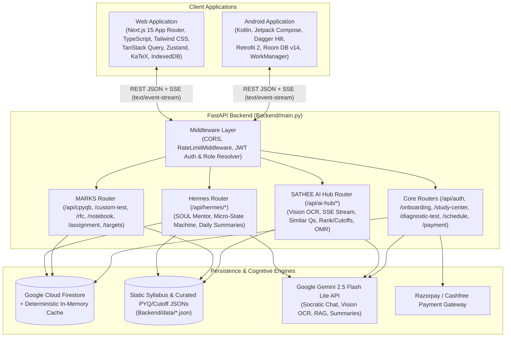
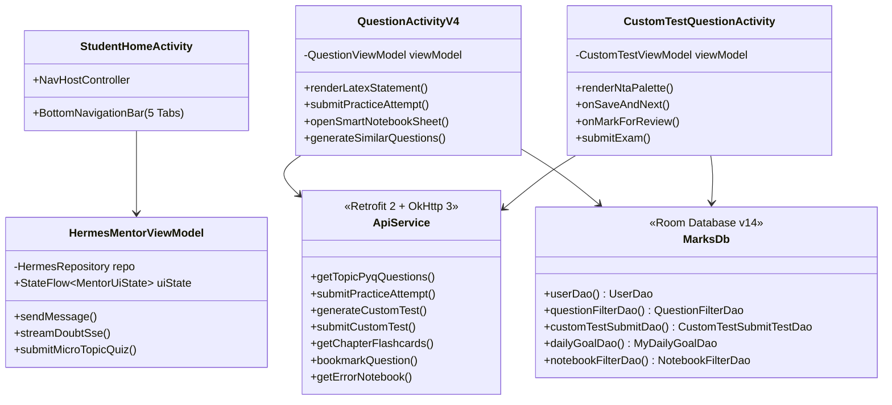
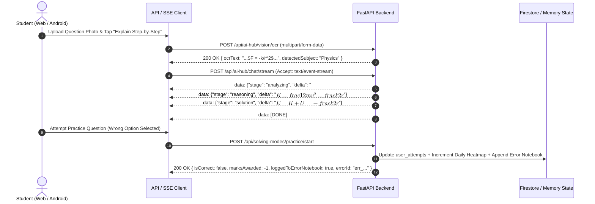

# Technical Architecture & System Design (`design.md`)
## eKlAVYA / Mentor AI — Web Application, Android Application & FastAPI Backend

> **Scope:** End-to-end technical architecture, design system tokens, state management, offline synchronization, networking pipelines, LaTeX rendering, and security engineering for the **Web Application (Next.js 15 / React 19)**, **Android Application (Kotlin / Jetpack Compose + Room DB)**, and **FastAPI Backend (`Backend/main.py`)**.

---

## Table of Contents

1. [High-Level Multi-Platform Architecture](#1-high-level-multi-platform-architecture)
2. [Web Application Architecture (Next.js 15 + TypeScript)](#2-web-application-architecture-nextjs-15--typescript)
3. [Android Application Architecture (Kotlin + Clean MVVM + Room)](#3-android-application-architecture-kotlin--clean-mvvm--room)
4. [Backend Service & Data Architecture (FastAPI + Firestore + Gemini)](#4-backend-service--data-architecture-fastapi--firestore--gemini)
5. [Networking, SSE Streaming & Token Refresh Pipeline](#5-networking-sse-streaming--token-refresh-pipeline)
6. [Offline-First CBT Execution & Synchronization Engine](#6-offline-first-cbt-execution--synchronization-engine)
7. [UI/UX Design System, Color Tokens & LaTeX Rendering Pipeline](#7-uiux-design-system-color-tokens--latex-rendering-pipeline)
8. [Security, Role Isolation & Performance Engineering](#8-security-role-isolation--performance-engineering)

---

## 1. High-Level Multi-Platform Architecture



---

## 2. Web Application Architecture (Next.js 15 + TypeScript)

### 2.1. Recommended Directory Structure (`Frontend_Website/src/`)
```text
src/
├── app/
│   ├── (public)/
│   │   ├── login/page.tsx                  # Parent Login
│   │   ├── login/student/page.tsx          # Student Login
│   │   └── register/page.tsx               # Parent Registration
│   ├── onboarding/page.tsx                 # 3-Step Parent Onboarding Wizard
│   ├── parent/                             # Parent Portal Layout & Guard
│   │   ├── dashboard/page.tsx              # 7-Day Overview & Attention Flags
│   │   ├── reports/page.tsx                # Bilingual Daily & Weekly Reports
│   │   ├── assignments/page.tsx            # Homework Builder & Classroom Error Analytics
│   │   └── billing/page.tsx                # Subscription Plans & Razorpay Checkout
│   └── student/                            # Student Portal Layout & Guard
│       ├── dashboard/page.tsx              # Countdown, Concept Wall, Daily Dose, Heatmap, Leagues
│       ├── mentor/page.tsx                 # Hermes 1-to-1 Socratic Chat + SSE Doubt Stream
│       ├── pyq/page.tsx                    # Chapter-wise PYQ Browser & NEET NCERT Modules
│       ├── pyq/solve/page.tsx              # MCQ/NAT Practice Workspace + Similar Qs Modal
│       ├── tests/page.tsx                  # CTG, Diagnostic Tests & Homework Hub
│       ├── tests/custom/build/page.tsx     # 2-Step Custom Test Generator Wizard
│       ├── exam/[testId]/page.tsx          # Distraction-Free Fullscreen NTA CBT Interface
│       ├── tests/[testId]/analysis/page.tsx# Post-Test Report Card & Speed Comparison
│       ├── revision/page.tsx               # 3D Flashcards (RFC) & Mind Maps
│       ├── notebooks/page.tsx              # Smart Notebooks & Automated Error Notebook
│       └── tools/page.tsx                  # AI Rank Predictor, College Cutoffs & OMR Grader
├── components/
│   ├── math/LatexRenderer.tsx              # KaTeX wrapper for $...$ and $$...$$ + HTML
│   ├── cbt/QuestionPalette.tsx             # NTA 4-state question grid
│   ├── cbt/VirtualNumericKeypad.tsx        # On-screen keypad for NAT questions
│   ├── heatmap/ActivityHeatmap.tsx         # GitHub-style monthly solved grid
│   └── mentor/SseStreamViewer.tsx          # Stage-aware SSE renderer (analyzing -> reasoning -> solution)
├── lib/
│   ├── api-client.ts                       # Axios instance with Bearer JWT & 401 refresh interceptor
│   ├── sse-client.ts                       # Fetch-based EventStream reader for POST /api/ai-hub/chat/stream
│   └── cbt-offline-store.ts                # IndexedDB persistence for active CBT exam responses
└── stores/
    ├── useAuthStore.ts                     # Zustand store for Parent/Student session & role
    └── useCbtExamStore.ts                  # Zustand timer, section & palette state machine
```

### 2.2. Web Technology Stack
- **Framework:** Next.js 15 (App Router) + React 19 + TypeScript.
- **Styling & Primitives:** Tailwind CSS + Shadcn UI (Radix primitives) + Lucide Icons.
- **Server State & Caching:** TanStack Query v5 (`staleTime: 60_000` for PYQ lists and syllabus trees; automatic invalidation of `/api/targets/heatmap`, `/api/notebook/errors`, and `/api/leaderboard/achievements` after question/test submissions).
- **Client State:** Zustand (`useAuthStore`, `useCbtExamStore` persisted to `localStorage` / `IndexedDB`).
- **Math & Diagrams:** `katex` + `rehype-katex` for zero-layout-shift equation rendering; `mermaid` or `reactflow` for Study Center mind maps; `recharts` for topper speed/accuracy comparison charts.

---

## 3. Android Application Architecture (Kotlin + Clean MVVM + Room)

### 3.1. Layered Clean Architecture


### 3.2. Android Package Organization (`Android_App/app/src/main/java/com/eklavya/mentor/`)
- `data/remote/`: Retrofit 2 interfaces (`MarksApiService.kt`, `HermesApiService.kt`, `SatheeAiHubService.kt`), OkHttp `AuthInterceptor` (injects `Authorization: Bearer <token>` and handles automatic token refresh via `POST /api/auth/token/refresh`), and OkHttp SSE client (`okhttp-sse`) for `/api/ai-hub/chat/stream`.
- `data/local/`: Room Database (`MarksDb.kt`) caching active Custom Tests, offline practice attempts (`SubmitTestRequest`), user profile, and daily goal counters.
- `workers/`: `WorkManager` background workers (`OfflineTestSyncWorker.kt`, `ExamWidgetMidnightReceiver.kt`) syncing queued offline test submissions when network connectivity returns and updating the Android Home Screen Exam Countdown widget at midnight.
- `ui/`: Jetpack Compose screens + ViewModels exposing immutable `StateFlow<UiState>` sealed interfaces.

---

## 4. Backend Service & Data Architecture (FastAPI + Firestore + Gemini)

| Backend Module | Router File | Service File | Responsibilities |
| :--- | :--- | :--- | :--- |
| **Hermes AI Mentor** | [hermes_router.py](file:///home/tushka/Projects/eKlAVYA/Backend/routers/hermes_router.py) | [hermes_agent_service.py](file:///home/tushka/Projects/eKlAVYA/Backend/services/hermes_agent_service.py), [micro_topic_service.py](file:///home/tushka/Projects/eKlAVYA/Backend/services/micro_topic_service.py) | Non-overridable Socratic `SOUL_PROMPT`, 11-language support, rolling memory compression, deterministic `UNTOUCHED -> LEARNING -> MASTERED` state machine, and Concept Wall locking. |
| **CPYQB & Custom Tests** | [marks_router.py](file:///home/tushka/Projects/eKlAVYA/Backend/routers/marks_router.py) | [cpyqb_ctg_service.py](file:///home/tushka/Projects/eKlAVYA/Backend/services/cpyqb_ctg_service.py) | Chapter-wise PYQ filtering, MCQ/NAT Practice Mode verification, 2-step Custom Test Generator, CBT grading, topper analytics, and NEET NCERT Line-by-Line modules. |
| **RFC, Notebooks, Assignments & Leagues** | [marks_router.py](file:///home/tushka/Projects/eKlAVYA/Backend/routers/marks_router.py) | [rfc_notebook_assignment_service.py](file:///home/tushka/Projects/eKlAVYA/Backend/services/rfc_notebook_assignment_service.py) | Syllabus-seeded Flashcards & Formula Cards, Smart Notebooks, Automated Error Notebook, Teacher/Parent Homework Assignments (`joinCode`), GitHub-style Monthly Heatmap, Daily Dose 5-Q Sprint, and Weekly Leagues. |
| **SATHEE AI Hub & Admissions** | [sathee_ai_router.py](file:///home/tushka/Projects/eKlAVYA/Backend/routers/sathee_ai_router.py) | [ai_hub_admissions_service.py](file:///home/tushka/Projects/eKlAVYA/Backend/services/ai_hub_admissions_service.py) | Handwritten/Equation Vision OCR, SSE Streaming Doubt Solver, Isomorphic Similar Question Synthesizer, Physical OMR Grader, AI Rank Predictor, and IIT/NIT/AIIMS Cutoff Explorer. |

---

## 5. Networking, SSE Streaming & Token Refresh Pipeline



---

## 6. Offline-First CBT Execution & Synchronization Engine

To guarantee zero data loss during 180-minute JEE/NEET mock or custom tests over unstable mobile networks:
1. **Pre-Fetch & Cache on Start:** When `POST /api/custom-test/generate` or `GET /api/diagnostic-test/{test_id}` returns the question payload, the entire JSON payload is persisted locally (`IndexedDB` on Web; `MarksDb` Room table on Android) before the countdown clock starts.
2. **Local-First Palette Mutations:** Every `"Save & Next"`, `"Mark for Review"`, and per-question `timeTaken` increment updates local storage synchronously in `< 5ms`.
3. **Resilient Submission Queue:** On timer expiry or manual submit, if the device is offline, the `CTGSubmitRequest` payload is saved in the local pending queue and automatically uploaded as soon as connectivity is restored.

---

## 7. UI/UX Design System, Color Tokens & LaTeX Rendering Pipeline

### 7.1. Semantic Color Palette (Light & Dark Mode)
| Token Purpose | Token Name | Hex Value (Light / Dark) | Usage |
| :--- | :--- | :--- | :--- |
| **Primary Brand** | `--color-primary` | `#1589EE` / `#38BDF8` | Primary CTAs, active tabs, JEE Main theme accent |
| **Medical / NEET Accent** | `--color-medical` | `#10B981` / `#34D399` | NEET NCERT modules, High-Yield badges, Correct banners |
| **Concept Wall / Warning**| `--color-wall` | `#F59E0B` / `#FBBF24` | Active Concept Wall banner, Trap Zone badges |
| **Mistake / Negative** | `--color-danger` | `#EF4444` / `#F87171` | Incorrect attempt banner (`-1 Mark`), Error Notebook tags |
| **CBT Marked for Review** | `--color-review` | `#8B5CF6` / `#A78BFA` | NTA Question Palette "Marked for Review" state |
| **Heatmap Levels (0–4)** | `--heatmap-0..4` | `#EBEDF0` $\to$ `#216E39` | Monthly consistency heatmap cells |

### 7.2. Mathematical LaTeX & Diagram Rendering Rules
- **Inline Math:** Delimited by `$...$` (e.g., `$\frac{5}{7} g \sin \theta$`).
- **Block Display Equations:** Delimited by `$$...$$` (e.g., `$$\oint \vec{E} \cdot d\vec{A} = \frac{q_{\text{enclosed}}}{\varepsilon_0}$$`).
- **Sanitization:** Question `statementHtml` and `solutionHtml` strings contain `<p>`, `<i>`, `<b>`, and LaTeX delimiters. Sanitize HTML with `DOMPurify` (Web) before passing through KaTeX auto-render (`renderMathInElement`).

---

## 8. Security, Role Isolation & Performance Engineering

1. **Strict Parent / Student Role Separation:**
   - Enforced server-side in [`resolve_child_access`](file:///home/tushka/Projects/eKlAVYA/Backend/routers/hermes_router.py#L109-L134): Parent tokens cannot post to `/api/hermes/chat` (`403 Forbidden`), and Student tokens cannot access `/api/hermes/parent/*` (`403 Forbidden`).
   - Parent accounts are verified for ownership (`child.parent_id == current_user`) before returning any child analytics or summaries.
2. **Prompt-Injection Hardening (`SOUL_PROMPT`):**
   - [`SOUL_PROMPT`](file:///home/tushka/Projects/eKlAVYA/Backend/services/hermes_agent_service.py#L62-L71) is prepended server-side on every mentor turn and cannot be overridden by client payloads. Syllabus scope boundaries are deterministically injected from `data/syllabus/*.json`.
3. **Rate Limiting & Cost Guardrails:**
   - Global `RateLimitMiddleware` (`200 req/min`) protects all routes.
   - Per-student daily mentor turn caps (`free`: 5 turns/day, `premium`: 50 turns/day) and rolling memory compression (`MEMORY_ROLLUP_TURNS = 10`) keep LLM token consumption bounded and predictable.
