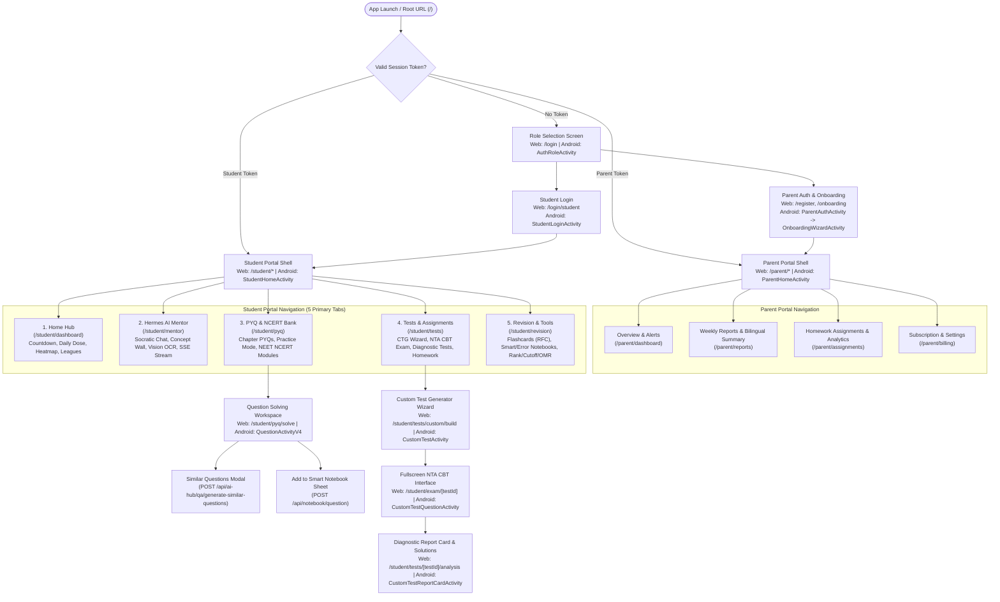

# Screen Flow & Navigation Topology (`screenflow.md`)
## eKlAVYA / Mentor AI — Web Application & Android Application

> **Scope:** Complete screen inventory, navigation topology graphs, route/activity mapping, UI component breakdowns, deep link schemes, and back-stack guards for both the **Web Application (Next.js App Router)** and the **Android Application (Kotlin / Jetpack Compose + MVVM)**.

---

## Table of Contents

1. [Navigation Architecture Overview (Web vs. Android)](#1-navigation-architecture-overview-web-vs-android)
2. [Global Navigation Topology Graph](#2-global-navigation-topology-graph)
3. [Exhaustive Screen Inventory (Web Routes & Android Activities/Screens)](#3-exhaustive-screen-inventory-web-routes--android-activitiesscreens)
4. [Detailed Screen Specifications (UI Components, State & API Calls)](#4-detailed-screen-specifications-ui-components-state--api-calls)
5. [Deep Link Schemes, Route Guards & Hardware Back-Stack Behavior](#5-deep-link-schemes-route-guards--hardware-back-stack-behavior)

---

## 1. Navigation Architecture Overview (Web vs. Android)

| Navigation Layer | Web Application (Next.js 15 App Router) | Android Application (Kotlin + Jetpack Compose) |
| :--- | :--- | :--- |
| **Entry & Auth Resolution** | Middleware (`middleware.ts`) + `/login` & `/register` | `SplashActivity` checking encrypted `UserDao` & `SharedPreferences` |
| **Student Shell** | Left Collapsible Sidebar + Top Exam Switcher (`/student/*`) | `StudentHomeActivity` with 5 Bottom Navigation Tabs |
| **Parent Shell** | Top Navigation Bar + Child Switcher (`/parent/*`) | `ParentHomeActivity` with 4 Bottom Navigation Tabs |
| **Distraction-Free Exam Mode** | Fullscreen Route `/student/exam/[testId]` (hides sidebar/nav) | Standalone `CBTExamActivity` (`FLAG_SECURE` + Back-Press Guard) |
| **Slide-Over / Bottom Sheets** | Radix/Shadcn `Sheet` & `Dialog` (Bookmarking, Filters, Quick OCR) | `ModalBottomSheet` (Smart Notebook Picker, Filter Sheet, NAT Keypad) |

---

## 2. Global Navigation Topology Graph

---

## 3. Exhaustive Screen Inventory (Web Routes & Android Activities/Screens)

### 3.1. Authentication & Onboarding Screens
| Screen ID | Web Route (`Next.js`) | Android Activity / Compose Screen | Role | Primary Purpose |
| :--- | :--- | :--- | :--- | :--- |
| **SCR-01** | `/` & `/login` | `SplashActivity` $\to$ `AuthRoleActivity` | Public | Cold launch token verification & Parent vs. Student role picker. |
| **SCR-02** | `/register` | `ParentRegisterActivity` | Parent | Parent registration (`POST /api/auth/register/simple`). |
| **SCR-03** | `/onboarding` | `OnboardingWizardActivity` | Parent | 3-step wizard: Language Preferences $\to$ Child Creation $\to$ Exam Selection. |
| **SCR-04** | `/login/student` | `StudentLoginActivity` | Student | Student username/password login (`POST /api/auth/login/child`). |

### 3.2. Student Portal Screens
| Screen ID | Web Route (`Next.js`) | Android Activity / Compose Screen | Module | Primary Purpose |
| :--- | :--- | :--- | :--- | :--- |
| **SCR-05** | `/student/dashboard` | `StudentDashboardScreen` (Tab 1) | Home Hub | Exam countdown, Concept Wall banner, Daily Dose launcher, Monthly Heatmap, League badge. |
| **SCR-06** | `/student/daily-dose` | `DailyDoseActivity` | Gamification | 5-question timed daily sprint challenge with streak bonus (`GET/POST /api/targets/daily-dose`). |
| **SCR-07** | `/student/leaderboard` | `LeaderboardLeaguesActivity` | Social | Weekly Bronze $\to$ Master League standings (`GET /api/leaderboard/achievements`). |
| **SCR-08** | `/student/mentor` | `HermesMentorScreen` (Tab 2) | Hermes AI | 1-to-1 Socratic chat, Micro-Topic selector, Concept Wall unlock quiz, SSE streaming doubt solver. |
| **SCR-09** | `/student/ai-hub/ocr` | `VisionOcrDoubtActivity` | AI Hub | Camera/image cropper (`UCrop`) $\to$ LaTeX OCR extraction $\to$ Socratic SSE streaming solution. |
| **SCR-10** | `/student/pyq` | `CPYQFlowScreen` (Tab 3) | PYQ Engine | Exam $\to$ Subject $\to$ Chapter $\to$ Topic browser + NEET NCERT Line-by-Line Module tabs. |
| **SCR-11** | `/student/pyq/solve` | `QuestionActivityV4` | PYQ Engine | Fullscreen MCQ & NAT problem solver with instant verification, LaTeX solution, Bookmark & "Generate 3 Similar Questions". |
| **SCR-12** | `/student/tests` | `TestsHubScreen` (Tab 4) | Assessments | Unified hub for Custom Tests (CTG), Full Diagnostic Tests, and Teacher/Parent Homework Assignments. |
| **SCR-13** | `/student/tests/custom/build`| `CustomTestActivity` | CTG | 2-step wizard: Subject selection (`step1`) $\to$ Chapter question allocation & duration (`step2` + `generate`). |
| **SCR-14** | `/student/exam/[testId]` | `CustomTestQuestionActivity` | CBT Engine | Fullscreen NTA CBT interface with section tabs, countdown clock, and 4-state question palette. |
| **SCR-15** | `/student/tests/[testId]/analysis`| `CustomTestReportCardActivity` | Analytics | Post-test report card: Score, Accuracy, Percentile, Topper speed comparison, Weak topics, Solutions. |
| **SCR-16** | `/student/assignments/[code]`| `MAStudentActivity` | Assignments | Join homework via 6-char `joinCode` (`6X9A21`) and submit under assignment timer. |
| **SCR-17** | `/student/revision` | `RevisionHubScreen` (Tab 5) | Revision | Hub for Revision Flash Cards (RFC), Smart Notebooks, Automated Error Notebook, and Study Center Mind Maps. |
| **SCR-18** | `/student/revision/rfc/[subject]/[chapter]` | `RFCActivity` | Flashcards | Interactive 3D flip card deck with LaTeX formulas & swipe mastery (`mastered` / `needs_revision`). |
| **SCR-19** | `/student/notebooks` | `NotebookListActivity` | Notebooks | Custom color-coded Smart Notebooks + Automated Error Notebook with mistake-type filters & mastery resolution. |
| **SCR-20** | `/student/tools` | `ExamToolsActivity` | Admissions & OMR | Physical OMR Sheet Photo Grader, AI Rank & Percentile Predictor, and IIT/NIT/AIIMS Cutoff Explorer. |
| **SCR-21** | `/student/schedule` | `AdaptiveScheduleActivity` | Planner | AI-generated day-by-day study schedule and syllabus coverage tracker. |

### 3.3. Parent / Teacher Portal Screens
| Screen ID | Web Route (`Next.js`) | Android Activity / Compose Screen | Module | Primary Purpose |
| :--- | :--- | :--- | :--- | :--- |
| **SCR-22** | `/parent/dashboard` | `ParentDashboardScreen` (Tab 1) | Monitoring | 7-day activity overview, attention flags (`inactive_48h`, `concept_wall_active`), syllabus progress. |
| **SCR-23** | `/parent/reports` | `ParentReportsScreen` (Tab 2) | Reports | Bilingual daily summaries (`student`/`parent` audience) and 7-day per-day breakdown. |
| **SCR-24** | `/parent/assignments` | `MarksAssignmentTeacherActivity` (Tab 3)| Assignments | Pick PYQs to create homework, generate 6-char `joinCode`/WhatsApp link, and inspect classroom error rates. |
| **SCR-25** | `/parent/billing` | `SubscriptionCheckoutActivity` (Tab 4)| Payments | Plan comparison (`free`, `premium_monthly`, `premium_yearly`) and Razorpay checkout. |

---

## 4. Detailed Screen Specifications (UI Components, State & API Calls)

### 4.1. `SCR-05: Student Dashboard` (`/student/dashboard` / `StudentDashboardScreen`)
- **UI Components:**
  - **Top Header:** Exam selector pill (`JEE Main 2026` / `NEET 2026`), Countdown badge (`94 Days Left`), Streak flame counter, XP pill, League shield icon.
  - **Concept Wall Alert Banner (Conditional):** Displayed in high-contrast amber if `GET /api/hermes/today` returns `locked_topic != null`, with a direct CTA `"Revise & Unlock Concept Wall"`.
  - **Daily Dose Card:** `"Today's 5-Question Sprint (+25 Bonus Pts)"` $\to$ launches `SCR-06`.
  - **GitHub-Style Monthly Consistency Heatmap:** 30/31-day grid colored by `solvedCount` vs `dailyTargetQuestions` (`GET /api/targets/heatmap`), with inline `"Edit Daily Target"` modal (`POST /api/targets/update`).
  - **Quick Launch Grid:** PYQ Bank, Custom Test Generator, Error Notebook (`unresolvedCount` badge), Snap & Solve OCR.

### 4.2. `SCR-08: Hermes 1-to-1 Socratic AI Mentor` (`/student/mentor` / `HermesMentorScreen`)
- **UI Components:**
  - **Left Drawer / Top Bar:** In-scope Micro-Topic Tree grouped by Subject & Chapter with state pills (`UNTOUCHED` gray, `LEARNING` blue, `MASTERED` green, `WALL` amber lock) + Language Switcher (`English`, `हिंदी`, `Hinglish`, `मराठी`, etc.).
  - **Chat Viewport:** Markdown + KaTeX mathematical renderer supporting both single-shot Socratic responses (`POST /api/hermes/chat`) and multi-stage SSE streaming (`POST /api/ai-hub/chat/stream`: *Analyzing Concept* $\to$ *Step-by-Step Reasoning* $\to$ *Guiding Question*).
  - **Composer Bar:** Text input, Camera/Image upload button (triggers `POST /api/ai-hub/vision/ocr`), Daily Turn Counter (`14/50 turns used`), and `"Take Topic Mastery Quiz"` button (`POST /api/hermes/quiz/attempt`).

### 4.3. `SCR-11: PYQ Question Solving Workspace` (`/student/pyq/solve` / `QuestionActivityV4`)
- **UI Components:**
  - **Metadata Header:** Exam badge (`JEE Main`), Year & Shift (`29 Jan 2024 Shift 1`), Question Type (`MCQ +4/-1` or `NAT +4/0`), Revision Zone badge (`High Yield` / `Trap Zone`), and NCERT Reference (`Class 11, pp. 164-172`).
  - **Question Body:** KaTeX + HTML renderer with pinch-to-zoom diagram viewer on Android / Lightbox on Web.
  - **Response Input:**
    - For `MCQ`: Interactive option cards `A`, `B`, `C`, `D`.
    - For `NAT`: Custom virtual numeric keypad supporting digits `0–9`, decimal `.`, and negative `-`.
  - **Post-Attempt Solution Drawer:** Triggered on `"Check Answer"` (`POST /api/solving-modes/practice/start`). Shows Green/Red status banner, step-by-step LaTeX derivation, `"Bookmark to Smart Notebook"` button, and `"Generate 3 Similar Questions"` button (`POST /api/ai-hub/qa/generate-similar-questions`).

### 4.4. `SCR-14: Fullscreen NTA CBT Examination Screen` (`/student/exam/[testId]` / `CustomTestQuestionActivity`)
- **UI Components:**
  - **Sticky Exam Header:** Test title, persistent countdown timer (`MM:SS` with red pulse under 5 minutes), and `"Submit Exam"` button.
  - **Subject Section Tabs:** `Physics` | `Chemistry` | `Mathematics / Biology`.
  - **Question Palette Drawer/Sidebar:** Grid of numbered buttons (`1..N`) with NTA standard color states:
    - Gray: Not Visited
    - Red: Visited / Unattempted
    - Green: Answered (`status: "answered"`)
    - Purple: Marked for Review (`status: "marked_for_review"`)
  - **Action Footer:** `"Save & Next"`, `"Mark for Review & Next"`, `"Clear Response"`.

---

## 5. Deep Link Schemes, Route Guards & Hardware Back-Stack Behavior

### 5.1. Universal Links & Android Intent Filters
| Deep Link / URL Pattern | Web Route Target | Android Activity Target | Action |
| :--- | :--- | :--- | :--- |
| `https://link.getmarks.app/assignment/student?code={code}` | `/student/assignments/{code}` | `MAStudentActivity` | Opens the homework assignment directly using the 6-char `joinCode`. |
| `https://app.eklavya.ai/student/mentor?topic={id}` | `/student/mentor?topic={id}` | `HermesMentorScreen` | Opens Hermes Socratic Mentor pre-focused on the specified micro-topic. |
| `https://app.eklavya.ai/student/exam/{testId}` | `/student/exam/{testId}` | `CustomTestQuestionActivity` | Launches or resumes an active timed CBT examination. |

### 5.2. Navigation Guards & Back-Stack Rules
1. **Role Isolation Guard:**
   - Parent JWT tokens attempting to access `/student/mentor` chat receive `403 Forbidden` and are redirected to `/parent/dashboard`.
   - Student JWT tokens attempting to access `/parent/*` routes receive `403 Forbidden` and are redirected to `/student/dashboard`.
2. **Active CBT Exam Guard (`SCR-14`):**
   - **Web:** `beforeunload` browser event listener + Next.js route-change interceptor prompts *"Are you sure you want to leave? Your test timer is running."*
   - **Android:** `OnBackPressedCallback` intercepts hardware back presses and displays a confirmation modal (*"Submit & Exit"* vs. *"Resume Test"*).
3. **Concept Wall Guard:**
   - When a student has an active Concept Wall on a micro-topic, attempting a quiz on a different micro-topic returns `409 Conflict` / redirects the UI to the locked topic's revision session.
