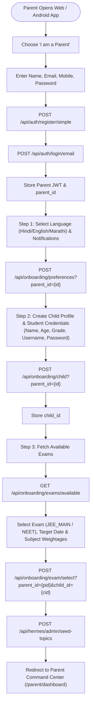
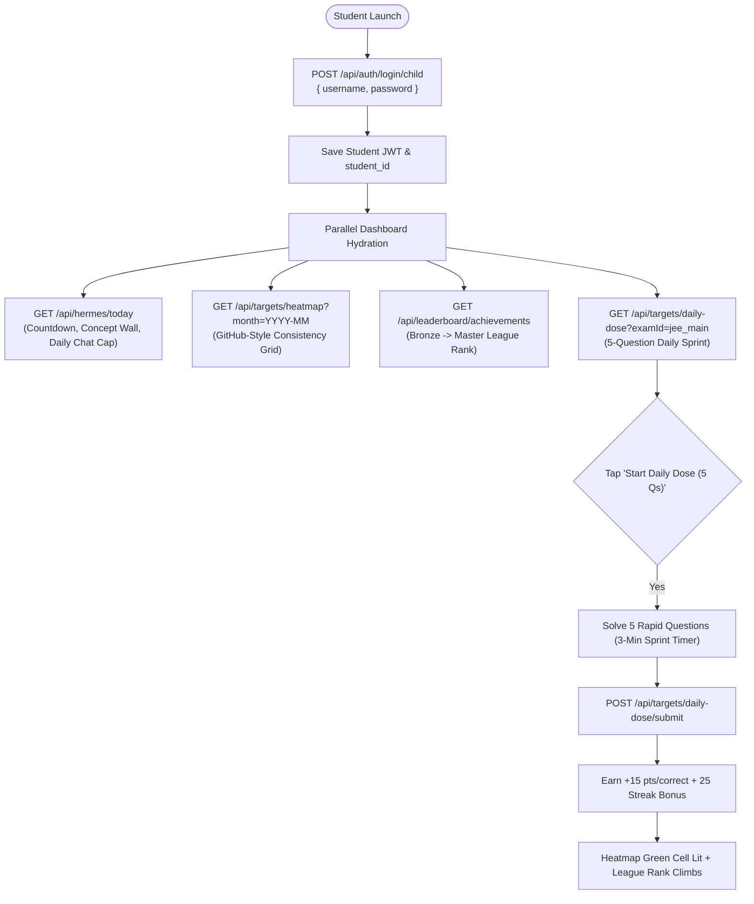
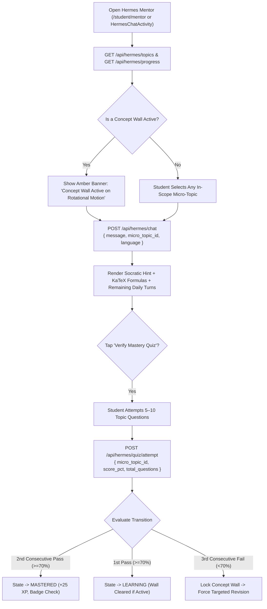
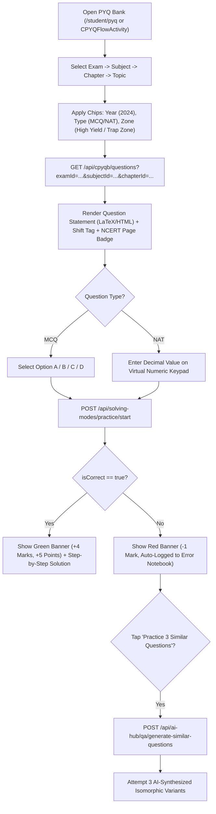
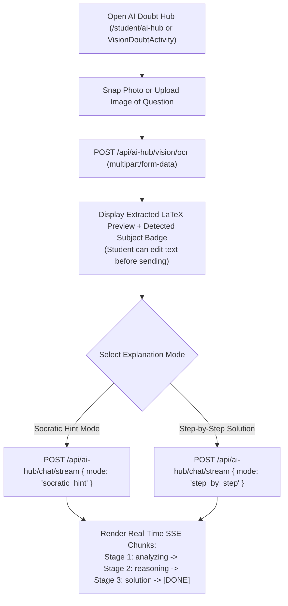
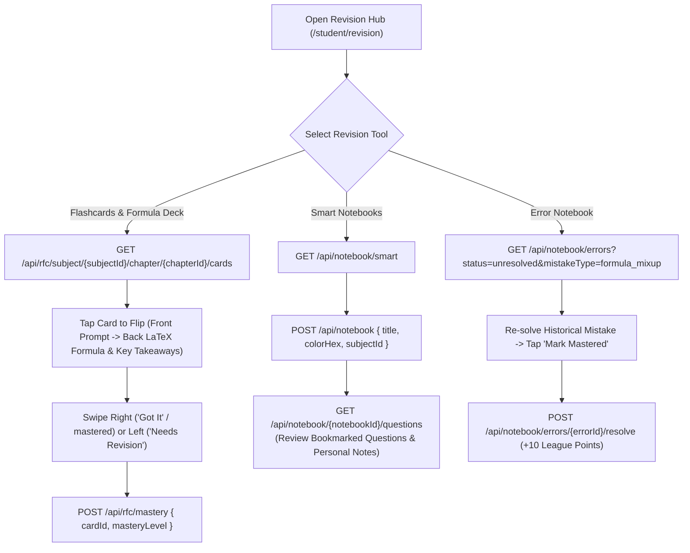
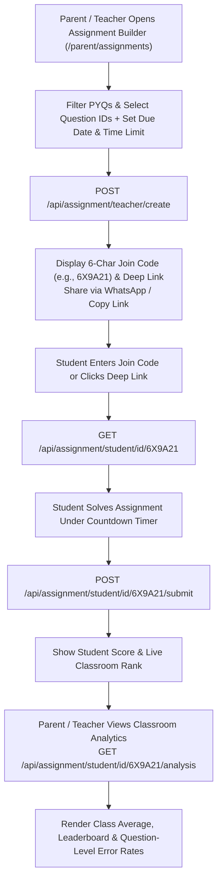
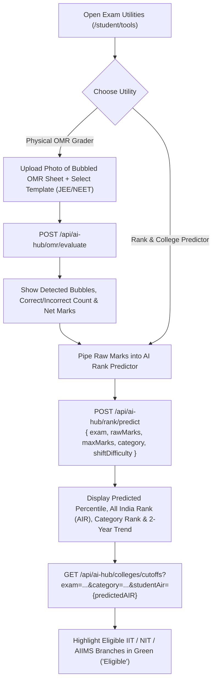
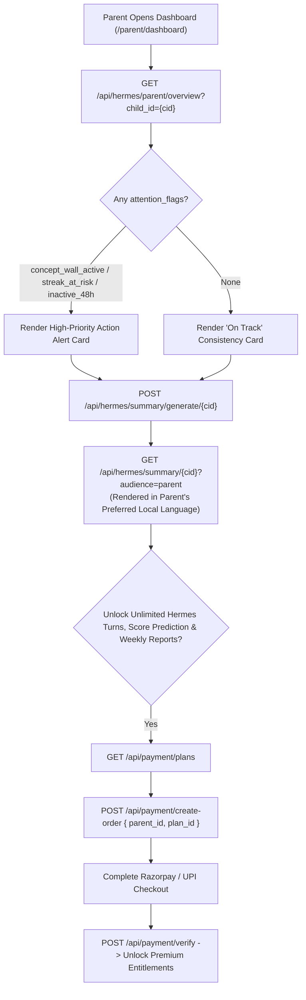

# End-to-End User Journeys & Interaction Flows (`userflow.md`)
## eKlAVYA / Mentor AI — Web Application & Android Application

> **Scope:** Unified behavioral and API interaction flows for both the **Next.js / React Web Application** and the **Kotlin / Jetpack Compose Android Application**, covering the **Parent Portal** and **Student Portal** across all 18 backend domains in [endpoints.md](file:///home/tushka/Projects/eKlAVYA/endpoints.md).

---

## Table of Contents

1. [Journey 1: Parent Registration, Child Onboarding & Exam Selection](#1-journey-1-parent-registration-child-onboarding--exam-selection)
2. [Journey 2: Student Login, Home Dashboard & Daily Habit Loop (Daily Dose + Heatmap)](#2-journey-2-student-login-home-dashboard--daily-habit-loop)
3. [Journey 3: Hermes 1-to-1 Socratic AI Mentor, Micro-Topic Quiz & Concept Wall](#3-journey-3-hermes-1-to-1-socratic-ai-mentor-micro-topic-quiz--concept-wall)
4. [Journey 4: Chapter-wise PYQ Bank (CPYQB), Practice Mode & Automated Error Notebook](#4-journey-4-chapter-wise-pyq-bank-cpyqb-practice-mode--automated-error-notebook)
5. [Journey 5: Multi-Step Custom Test Generator (CTG) & NTA CBT Examination](#5-journey-5-multi-step-custom-test-generator-ctg--nta-cbt-examination)
6. [Journey 6: AI Hub — Snap & Solve Vision OCR, SSE Streaming Doubt Solver & Similar Questions](#6-journey-6-ai-hub--snap--solve-vision-ocr-sse-streaming-doubt-solver--similar-questions)
7. [Journey 7: Revision Flash Cards (RFC), Smart Notebooks & Spaced Repetition](#7-journey-7-revision-flash-cards-rfc-smart-notebooks--spaced-repetition)
8. [Journey 8: Teacher / Parent Homework Assignment Creation, Join Code & Classroom Analytics](#8-journey-8-teacher--parent-homework-assignment-creation-join-code--classroom-analytics)
9. [Journey 9: AI Rank Predictor, College Cutoff Explorer & Physical OMR Grader](#9-journey-9-ai-rank-predictor-college-cutoff-explorer--physical-omr-grader)
10. [Journey 10: Parent Monitoring, Bilingual Daily Summaries & Subscription Checkout](#10-journey-10-parent-monitoring-bilingual-daily-summaries--subscription-checkout)

---

## 1. Journey 1: Parent Registration, Child Onboarding & Exam Selection

### 1.1. Context & Platform Behavior
- **Web App:** Multi-step onboarding wizard at `/onboarding` after parent signup at `/register`.
- **Android App:** `OnBoardingAuthActivity` $\to$ `ParentPreferencesActivity` $\to$ `CreateChildProfileActivity` $\to$ `ExamSelectionActivity`.
- **Goal:** Register a parent, set preferred language (`en`, `hi`, `mr`, `hinglish`, etc.), create the student's login credentials, select target exam (`JEE_MAIN`, `JEE_ADVANCED`, `NEET`), and seed syllabus micro-topics.

### 1.2. Flowchart


---

## 2. Journey 2: Student Login, Home Dashboard & Daily Habit Loop

### 2.1. Context & Platform Behavior
- **Web App:** Student logs in at `/login/student` and lands on `/student/dashboard`.
- **Android App:** Student logs in via `StudentLoginActivity` and lands on `HomeActivity` (Bottom Tab 1: Dashboard) + syncs the Android Home Screen Countdown Widget (`ExamWidgetMidnightReceiver`).

### 2.2. Flowchart


---

## 3. Journey 3: Hermes 1-to-1 Socratic AI Mentor, Micro-Topic Quiz & Concept Wall

### 3.1. Context & Platform Behavior
- **Core Rule:** Hermes never hands out final numerical answers. It guides the student with formulas and Socratic questions in their chosen language (`en`, `hi`, `hinglish`, `mr`, etc.).
- **Micro-State Machine:** Every syllabus micro-topic transitions `UNTOUCHED` $\to$ `LEARNING` $\to$ `MASTERED` (2 consecutive passes $\ge 70\%$). Three consecutive failures lock a **Concept Wall**, steering all mentor sessions to revise that topic until cleared.

### 3.2. Flowchart


---

## 4. Journey 4: Chapter-wise PYQ Bank (CPYQB), Practice Mode & Automated Error Notebook

### 4.1. Context & Platform Behavior
- Students browse 20+ years of JEE Main, JEE Advanced, and NEET PYQs, filter by shift, year, question type (`MCQ` / `NAT`), attempt status (`unattempted`, `incorrect`, `starred`), or NEET Revision Zone (`high_yield`, `must_revise`, `trap_zone`), and verify answers one-by-one.

### 4.2. Flowchart


---

## 5. Journey 5: Multi-Step Custom Test Generator (CTG) & NTA CBT Examination

### 5.1. Context & Platform Behavior
- **Web App:** Fullscreen NTA-style CBT interface with section tabs, countdown timer, and color-coded question palette (`Answered`, `Not Answered`, `Marked for Review`).
- **Android App:** `CustomTestActivity` (Wizard) $\to$ `CustomTestQuestionActivity` (Hardware Back-Press Guarded CBT) $\to$ `CustomTestReportCardActivity`.

### 5.2. Flowchart
```mermaid
flowchart TD
    OpenCTG["Open Custom Tests (/student/custom-test)"] --> Step1["GET /api/custom-test/build/step1"]
    Step1 --> ChooseSubj["Select Exam (JEE Main / NEET) & Subjects (Physics, Chemistry, Maths)"]
    ChooseSubj --> Step2["POST /api/custom-test/build/step2"]
    Step2 --> AllocCh["Select Chapters, Allocate Question Counts & Pick Duration (30m–180m)"]
    AllocCh --> Synthesize["POST /api/custom-test/generate"]

    Synthesize --> LaunchCBT["Enter Fullscreen NTA CBT Exam Screen (Timer Starts)"]
    loop Question Navigation Loop
        LaunchCBT --> ReadQ["View Question + Section Switcher + Question Palette"]
        ReadQ --> Action{"Student Action"}
        Action -- "Save & Next" --> MarkAnswered["status = 'answered' (Green Palette Badge)"]
        Action -- "Mark for Review" --> MarkReview["status = 'marked_for_review' (Purple Palette Badge)"]
        Action -- "Clear Response" --> ClearAns["status = 'unattempted'"]
    end

    LaunchCBT --> SubmitExam["Timer Expires or Student Confirms Submit<br/>POST /api/custom-test/submit"]
    SubmitExam --> ReportCard["Load Report Card: Score, Accuracy %, Percentile, Subject Breakdown"]
    ReportCard --> DeepAnalysis["GET /api/custom-test/analysis/{testId}<br/>(Topper Comparison, Speed/Question, Weak Topics, Solutions)"]
```

---

## 6. Journey 6: AI Hub — Snap & Solve Vision OCR, SSE Streaming Doubt Solver & Similar Questions

### 6.1. Context & Platform Behavior
- A student takes a photo (Android Camera / UCrop) or drags-and-drops a screenshot (Web) of a tough Physics/Math problem, extracts the LaTeX via Vision OCR, and streams a real-time step-by-step explanation over Server-Sent Events (`text/event-stream`).

### 6.2. Flowchart


---

## 7. Journey 7: Revision Flash Cards (RFC), Smart Notebooks & Spaced Repetition

### 7.1. Flowchart


---

## 8. Journey 8: Teacher / Parent Homework Assignment Creation, Join Code & Classroom Analytics

### 8.1. Flowchart


---

## 9. Journey 9: AI Rank Predictor, College Cutoff Explorer & Physical OMR Grader

### 9.1. Flowchart


---

## 10. Journey 10: Parent Monitoring, Bilingual Daily Summaries & Subscription Checkout

### 10.1. Flowchart

