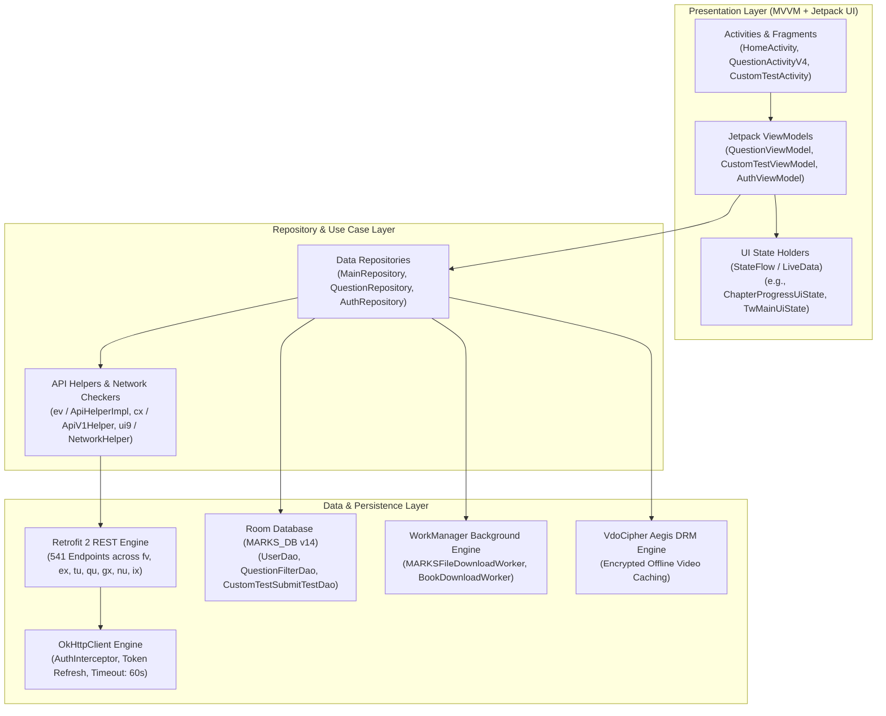
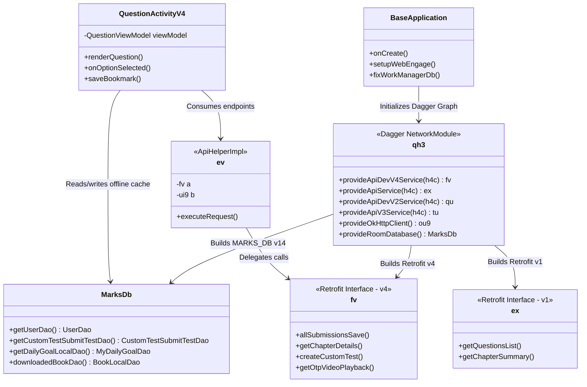
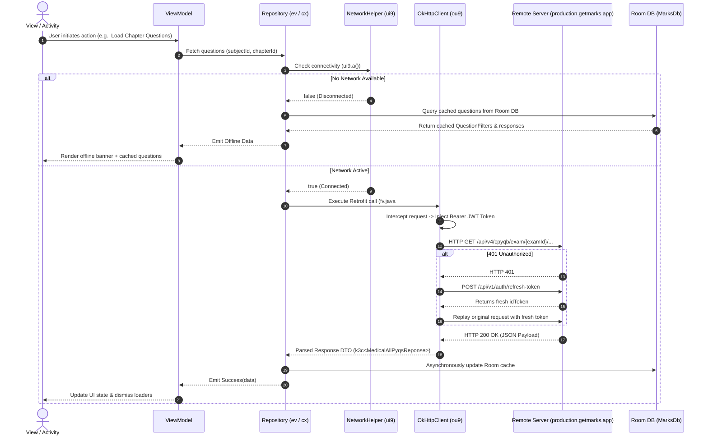
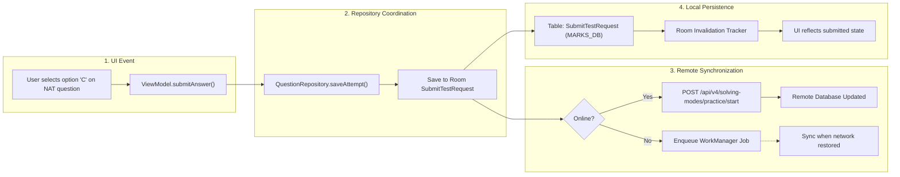

# Technical Architecture & System Design: MARKS Application

## Table of Contents
1. [Architectural Overview & Layering](#1-architectural-overview--layering)
2. [Module & Package Responsibilities](#2-module--package-responsibilities)
3. [Key Classes & Structural Relationships](#3-key-classes--structural-relationships)
4. [State Management, Threading & Concurrency](#4-state-management-threading--concurrency)
5. [Networking Layer Architecture](#5-networking-layer-architecture)
6. [End-to-End Data Flow (UI $\to$ Network $\to$ Storage)](#6-end-to-end-data-flow)
7. [Security-Relevant Design & Hardening](#7-security-relevant-design--hardening)
8. [Security Findings](#8-security-findings)
9. [Gaps & Open Questions](#9-gaps--open-questions)

---

## 1. Architectural Overview & Layering

The **MARKS** mobile application is engineered following the **Android Clean Architecture** guidelines and the **Model-View-ViewModel (MVVM)** pattern with **Dagger Hilt** dependency injection. It enforces a strict separation of concerns across Presentation, Domain/Repository, and Data (Remote & Local) layers:

---

## 2. Module & Package Responsibilities

The codebase in `/home/techlit/Documents/mentor ai/Decompile/marks/com/scoremarks/marks` is organized into modular packages:

| Package Namespace | Primary Responsibility & Role | Key Classes Included |
| :--- | :--- | :--- |
| `com.scoremarks.marks` | Application lifecycle, global crash handling, WorkManager recovery. | `BaseApplication.java`, `MyFirebaseMessagingService.java` |
| `com.scoremarks.marks.data.api` | API helper facades bridging repositories and Retrofit interfaces. | `ApiHelperImpl.java`, `ApiDevV1HelperImpl.java` |
| `com.scoremarks.marks.data.local` | Room database definition, type converters, and migration routines. | `MarksDb.java`, `Converters.java`, `AddressConverter.java` |
| `com.scoremarks.marks.data.local.dao` | Room Data Access Objects (DAOs) for database entity operations. | `UserDao.java`, `DailyGoalDao.java`, `CustomTestSubmitTestDao.java` |
| `com.scoremarks.marks.data.models` | POJOs and DTOs representing server payloads and local entities. | `User.java`, `SubmitTestRequest.java`, `QuestionFilters.java` |
| `com.scoremarks.marks.ui.activities` | Root activities managing primary screens and navigation routers. | `HomeActivity.java`, `SplashActivity.java`, `OnBoardingActivity.java` |
| `com.scoremarks.marks.ui.marks3` | Modern v4 core: question solving engine, CPYQ, and notebooks. | `QuestionActivityV4.java`, `CPYQFlowActivity.java`, `BookmarkedQsListActivity.java` |
| `com.scoremarks.marks.ui.custom_test` | Custom test generator (CTG), test taking, and analytics. | `CustomTestActivity.java`, `CustomTestQuestionActivity.java` |
| `com.scoremarks.marks.ui.marks_courses` | Video courses, video solutions, and PDF class note viewers. | `MarksCoursesActivity.java`, `PdfActivity.java`, `VideoSolActivity.java` |
| `com.scoremarks.marks.ui.marks_assignments` | B2B2C Teacher assignment creation and student homework submission. | `MarksAssignmentTeacherActivity.java`, `MAStudentActivity.java` |
| `com.scoremarks.marks.medical` | Dedicated NEET-UG ecosystem: NCERT modules, revision zones, bookmarks. | `MedicalActivity.java`, `MedicalPremiumActivity.java`, `DailyDoseActivity.java` |
| `com.scoremarks.marks.other` | Custom UI components, app widget receivers, and background workers. | `ExamWidgetBootReceiver.java`, `ExamWidgetMidnightReceiver.java`, `MARKSFileDownloadWorker.java` |
| `defpackage` | Flattened/obfuscated network services, Dagger components, and utilities. | `qh3.java` (NetworkModule), `fv.java` (ApiDevV4), `ex.java` (ApiV1) |

---

## 3. Key Classes & Structural Relationships

- **`BaseApplication` (`BaseApplication.java`):** Entry point initializing Firebase Messaging, WebEngage SDK, and Microsoft Clarity. Includes an explicit fix (`fixWorkManagerDb()`) to purge corrupted `workmanager.db` SQLite files.
- **`MarksDb` (`MarksDb.java`):** Room Database abstract class declaring 17 DAO accessors and 17 Type Converters (`Converters.class`, `CustomTestConverters.class`).
- **`qh3` (`qh3.java`):** Central Dagger Hilt dependency injection module configuring 10 Retrofit service instances across 5 base URL domains, custom Gson deserializers, and OkHttp connection pools.
- **`fv` (`defpackage/fv.java`):** Master Retrofit 2 interface declaring 245 endpoints for the primary v4 backend (`production.getmarks.app/api/v4/`).
- **`ev` (`defpackage/ev.java`):** Concrete implementation of `uu` (ApiHelper) wrapping `fv` with connectivity validation via `ui9` (`NetworkHelper`).

---

## 4. State Management, Threading & Concurrency

### 4.1. Reactive State Pipeline
The app employs **Kotlin Coroutines (`StateFlow` & `SharedFlow`)** combined with **Android Architecture Components `ViewModel`**:
1. **UiState Sealed Interfaces:** Each major screen declares a dedicated UI state model (e.g., `ChapterProgressUiState`, `TwMainUiState`, `ModuleAnalysisState`).
2. **State Propagation:** ViewModels execute API calls within `viewModelScope.launch(Dispatchers.IO)`. Results are emitted into `MutableStateFlow<UiState>` instances consumed by Compose or XML data binding in `Dispatchers.Main`.

### 4.2. Threading & Worker Pools
- **Network Dispatchers:** All network calls run on `Dispatchers.IO` using OkHttp's asynchronous thread pool.
- **Database Dispatchers:** Room database reads/writes are performed asynchronously using Kotlin `suspend` functions and Coroutines.
- **WorkManager Background Tasks:**
  - `MARKSFileDownloadWorker` (`MARKSFileDownloadWorker.java`): Manages multi-threaded downloads of digital book assets and PDF notes.
  - `BookDownloadWorker` (`BookDownloadWorker.java`): Downloads offline chapter modules.
  - `ExamWidgetMidnightReceiver` (`ExamWidgetMidnightReceiver.java`): Scheduled exact alarm receiver updating widget state at midnight without keeping the app awake.

---

## 5. Networking Layer Architecture

### 5.1. Client Setup & OkHttp Configuration (`qh3.java`)
- **Connection Timeout:** 60 seconds.
- **Read / Write Timeout:** 60 seconds.
- **Gson Configuration:** Instantiated with `SafeTypeAdapterFactory` to prevent crashes when backend fields return unexpected nulls or type mutations. Custom deserializers handle polymorphic question models:
  - `QuestionData.DataStateDeserializer`
  - `AnalysisSolution.DataQuestionSolutionsStateDeserializer`
  - `QuestionId.NotebookQuestionIdDeserializer`
  - `Quiz.AnalysisQuizStateStateDeserializer`
  - `CustomTest.DataStateDeserializer`

### 5.2. Multi-Host Retrofit Routing

| Retrofit Interface | Injected Base URL | Domain / Functionality |
| :--- | :--- | :--- |
| `fv.class` | `https://production.getmarks.app/api/v4/` | Core v4 Question bank, CTG, VdoCipher video OTP, Payments, Assignments. |
| `nu.class` | `https://production.getmarks.app/api/v1/` | User authentication, OTP dispatch, session refresh. |
| `ex.class` | `https://production.getmarks.app/api/v1/` | Legacy v1 PYQs, chapter listing, topic taxonomy. |
| `qu.class` | `https://production.getmarks.app/api/v2/` | Custom test synthesis and submission v2. |
| `gx.class` | `https://production.getmarks.app/api/v2/` | Exam categories, subscription catalog v2. |
| `tu.class` | `https://production.getmarks.app/api/v3/` | Smart Notebooks, question status, solving modes v3. |
| `ix.class` | `https://production.getmarks.app/api/v3/` | Weekly leaderboards, leagues, user points v3. |
| `zde.class` | `https://prod-tracker-api.getmarks.app/api/` | Exam countdown tracking and widget sync. |
| `ot2.class` | `https://countriesnow.space/api/v0.1/` | Country, state, and city lookup for profile editing. |

---

## 6. End-to-End Data Flow

---

## 7. Security-Relevant Design & Hardening

### 7.1. Code Obfuscation & Mapping
The production APK was compiled with **R8 / ProGuard** in shrinking and obfuscation mode. Network interfaces (`fv`, `ex`, `qu`, `tu`, `gx`, `nu`, `ix`, `zde`, `ot2`), Dagger modules (`qh3`), and data helpers (`ev`, `cx`, `pu`, `ui9`) were mapped to short 2-3 letter names in `defpackage/`. However, all `@Metadata` annotations were retained, allowing full deobfuscation of method names, parameter signatures, and return types.

### 7.2. Video DRM & Anti-Piracy Architecture
Video lectures and solutions are hosted on **VdoCipher**. The client never receives direct MP4/HLS URLs:
1. Client requests OTP from `POST /api/v4/courses/.../video/otp` (`fv.java#f`).
2. Server validates user subscription and returns `{ otp: "...", playbackInfo: "..." }`.
3. The VdoCipher Aegis SDK (`com.vdocipher.aegis`) initializes an encrypted secure player pipeline with hardware DRM (Widevine Modular L1/L3) and dynamic watermarking (displaying the student's email/phone overlay to deter screen capture).

### 7.3. Payment Gateway Security
The application delegates payment collection to **Cashfree Payment Gateway** (`com.cashfree.pg`):
- No credit card or UPI VPA data ever traverses MARKS servers or client storage.
- The client initiates an order via `POST /api/v4/payment/checkout/order` and receives a temporary `cftoken` / `order_token`.
- The native Cashfree SDK launches installed UPI applications (`upi://pay`) or web checkout, returning an order status verified via server-side polling.

---

## 8. Security Findings

> [!WARNING]
> Hardcoded credentials and secrets were identified in the decompiled source. Secrets are **REDACTED** below with their source locations:

| Finding ID | Component / Description | Redacted Key Value | Exact Code Citation | Severity |
| :--- | :--- | :--- | :--- | :--- |
| **SEC-001** | Mixpanel Project Token | `76fe371aeb70********************` | `defpackage/qh3.java#114` | High |
| **SEC-002** | WebEngage Account Key (Base64) | `in~311c****` (`aW5+MzExYzQ3MDg=`) | `com/scoremarks/marks/BaseApplication.java#66` | High |
| **SEC-003** | Google OAuth2 Web Client ID | `406420339924-ketncqif4a********************.apps.googleusercontent.com` | `res/values/strings.xml` (`default_web_client_id`) | Medium |
| **SEC-004** | Firebase Database Host | `https://marks-62f26.firebaseio.com` | `res/values/strings.xml` (`firebase_database_url`) | Medium |
| **SEC-005** | Google Firebase Application ID | `1:406420339924:android:c87f3afa************` | `res/values/strings.xml` (`google_app_id`) | Medium |

---

## 9. Gaps & Open Questions

1. **Certificate Pinning:** No OkHttp `CertificatePinner` configuration was observed in `qh3.java`. Network traffic is secured via standard TLS/HTTPS validation `[INFERRED]`.
2. **WebSocket Support:** No active WebSocket connections were found in the Retrofit or OkHttp network graph. Real-time updates rely on FCM push notifications and client-side polling `[INFERRED]`.
3. **Database Encryption:** `MarksDb` relies on standard unencrypted SQLite. Sensitive cached user data in `UserDao` is accessible on rooted devices `[UNKNOWN]`.
