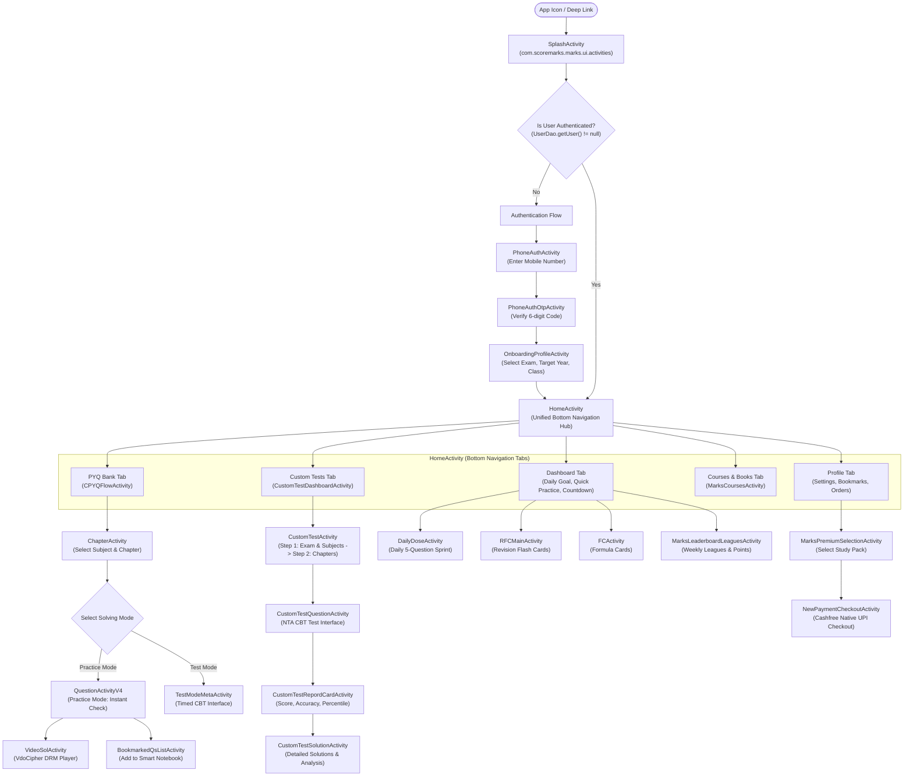

# Screen Flow & UI Navigation Architecture: MARKS Application

## Table of Contents
1. [Navigation Architecture Overview](#1-navigation-architecture-overview)
2. [Global Navigation Topology Graph](#2-global-navigation-topology-graph)
3. [Exhaustive Screen & Activity Inventory](#3-exhaustive-screen--activity-inventory)
4. [Detailed Screen Specifications](#4-detailed-screen-specifications)
5. [Deep Link Schemes & Back-Stack Behavior](#5-deep-link-schemes--back-stack-behavior)
6. [Gaps & Open Questions](#6-gaps--open-questions)

---

## 1. Navigation Architecture Overview

The **MARKS** Android application implements a multi-activity and fragment-based navigation topology orchestrated through:
- **Root Entry Activity (`SplashActivity`):** Resolves authentication and session validity, routing to either Onboarding or Home.
- **Main Shell Activity (`HomeActivity`):** Houses bottom navigation tabs (Home/Dashboard, PYQ Question Bank, Custom Tests, Courses/Study Packs, Profile).
- **Dedicated Flow Activities:** Standalone fullscreen activities for intensive tasks (e.g., CBT Test Taking in `CustomTestQuestionActivity`, Question Solving in `QuestionActivityV4`, Checkout in `NewPaymentCheckoutActivity`).
- **Android Deep Link Intent Filters:** Handles custom schemes (`link://get.marks`, `https://marks.page.link`, `https://link.getmarks.app/`) for direct routing to assignments, books, and referral screens.

---

## 2. Global Navigation Topology Graph

---

## 3. Exhaustive Screen & Activity Inventory

The following table documents all primary user-facing screens and activities declared in `AndroidManifest.xml` and implemented in the decompiled source:

| Screen Name / Class Name | Source File Path | Module / Area | Purpose |
| :--- | :--- | :--- | :--- |
| `SplashActivity` | `com/scoremarks/marks/ui/activities/SplashActivity.java` | Core | App launch, token verification, update check. |
| `PhoneAuthActivity` | `com/scoremarks/marks/ui/activities/PhoneAuthActivity.java` | Auth | Mobile phone number entry for SMS OTP. |
| `PhoneAuthOtpActivity` | `com/scoremarks/marks/ui/activities/PhoneAuthOtpActivity.java` | Auth | 6-digit OTP verification and token minting. |
| `OnboardingProfileActivity` | `com/scoremarks/marks/ui/activities/OnboardingProfileActivity.java` | Onboarding | Exam category, target year, class selection. |
| `HomeActivity` | `com/scoremarks/marks/ui/activities/HomeActivity.java` | Home Hub | Root dashboard housing 5 primary tabs. |
| `CPYQFlowActivity` | `com/scoremarks/marks/ui/marks3/cpyqb/CPYQFlowActivity.java` | PYQ Engine | Subject and chapter selection for PYQ bank. |
| `ChapterActivity` | `com/scoremarks/marks/ui/activities/ChapterActivity.java` | PYQ Engine | Chapter question list and weightage display. |
| `QuestionActivityV4` | `com/scoremarks/marks/ui/marks3/question_attempt/QuestionActivityV4.java` | PYQ Engine | Fullscreen question solving with LaTeX. |
| `CustomTestDashboardActivity`| `com/scoremarks/marks/ui/activities/CustomTestDashboardActivity.java` | CTG | Custom test history and "Create New Test" launcher. |
| `CustomTestActivity` | `com/scoremarks/marks/ui/custom_test/CustomTestActivity.java` | CTG | Multi-step test generator wizard. |
| `CustomTestQuestionActivity` | `com/scoremarks/marks/ui/activities/CustomTestQuestionActivity.java` | CTG | Timed CBT examination taking interface. |
| `CustomTestRepordCardActivity`| `com/scoremarks/marks/ui/activities/CustomTestRepordCardActivity.java` | CTG | Test results, score card, percentile analytics. |
| `CustomTestSolutionActivity` | `com/scoremarks/marks/ui/activities/CustomTestSolutionActivity.java` | CTG | Post-test review of all questions and solutions. |
| `RFCMainActivity` | `com/scoremarks/marks/ui/revision_flash_card/RFCMainActivity.java` | Flashcards | Revision Flash Card subject directory. |
| `RFCTopicsActivity` | `com/scoremarks/marks/ui/revision_flash_card/topics/RFCTopicsActivity.java` | Flashcards | Chapter flashcard deck selector. |
| `RFCActivity` | `com/scoremarks/marks/ui/revision_flash_card/RFCActivity.java` | Flashcards | Interactive card flip and mastery tracker. |
| `FCActivity` | `com/scoremarks/marks/ui/formula_cards/FCActivity.java` | Formulas | Formula cards subject directory. |
| `FCViewActivity` | `com/scoremarks/marks/ui/formula_cards/card_view/FCViewActivity.java` | Formulas | Horizontal swipeable formula card deck. |
| `NotebookListActivity` | `com/scoremarks/marks/ui/notebook/notebook_list/ui/NotebookListActivity.java` | Notebooks | Directory of user-created smart notebooks. |
| `BookmarkedQsListActivity` | `com/scoremarks/marks/ui/marks3/notebook_v2/BookmarkedQsListActivity.java` | Notebooks | Question list within a selected notebook. |
| `VideoSolActivity` | `com/scoremarks/marks/ui/video_solutions/VideoSolActivity.java` | Media | VdoCipher DRM video solution player. |
| `MarksCoursesActivity` | `com/scoremarks/marks/ui/marks_courses/MarksCoursesActivity.java` | Courses | Video lecture course catalog and syllabus tree. |
| `PdfActivity` | `com/scoremarks/marks/ui/marks_courses/class_notes/PdfActivity.java` | Media | PDF lecture notes viewer. |
| `DailyDoseActivity` | `com/scoremarks/marks/medical/dashboard/dailydose/DailyDoseActivity.java` | Gamification | Daily 5-question sprint challenge. |
| `DailyGoalActivity` | `com/scoremarks/marks/ui/daily_goal/DailyGoalActivity.java` | Goals | Target configuration and activity heatmap. |
| `MarksLeaderboardLeaguesActivity`| `com/scoremarks/marks/ui/leaderboard/ui/MarksLeaderboardLeaguesActivity.java` | Social | Weekly league rankings (Bronze to Master). |
| `MarksAssignmentTeacherActivity`| `com/scoremarks/marks/ui/marks_assignments/teacher_flow/MarksAssignmentTeacherActivity.java` | Assignments | Teacher homework creation and question picker. |
| `MAStudentActivity` | `com/scoremarks/marks/ui/marks_assignments/student_flow/MAStudentActivity.java` | Assignments | Student homework attempt interface. |
| `AnalysisActivity` | `com/scoremarks/marks/ui/marks_assignments/student_flow/analysis/AnalysisActivity.java` | Assignments | Assignment classroom ranking and statistics. |
| `MarksSelectedActivity` | `com/scoremarks/marks/ui/marks_selected/MarksSelectedActivity.java` | Books | Curated digital problem books catalog. |
| `MarksPremiumSelectionActivity`| `com/scoremarks/marks/ui/home/marks_premium/MarksPremiumSelectionActivity.java` | Payments | Subscription pack selection. |
| `NewPaymentCheckoutActivity` | `com/scoremarks/marks/ui/home/marks_premium/new_payment_checkout/NewPaymentCheckoutActivity.java` | Payments | Cashfree native payment checkout. |
| `MedicalActivity` | `com/scoremarks/marks/medical/MedicalActivity.java` | Medical | Dedicated NEET-UG dashboard. |
| `MedicalPremiumActivity` | `com/scoremarks/marks/medical/question_attempt/MedicalPremiumActivity.java` | Medical | Premium medical question attempt screen. |
| `HoroscopeActivity` | `com/scoremarks/marks/ui/horoscope/HoroscopeActivity.java` | Mindset | Daily motivational quotes and study advice. |
| `WidgetDashboardActivity` | `com/scoremarks/marks/ui/activities/WidgetDashboardActivity.java` | Widgets | Android home screen countdown widget setup. |

---

## 4. Detailed Screen Specifications

### 4.1. `SplashActivity`
- **Class:** `com.scoremarks.marks.ui.activities.SplashActivity`
- **Purpose:** Cold launch router, checks session validity and app updates.
- **UI Components:** App logo, animated loader, version label.
- **Data Shown:** App version (`2.0.8`).
- **Actions Available:** Automatic transition upon background task completion.
- **API Calls Triggered:**
  - `POST /api/v4/user/me` (`fv.java#u3`)
  - `GET /api/v4/config` (`fv.java#K`)
- **Navigation Targets:** `HomeActivity` (if token valid), `OnBoardingActivity` (if unauthenticated).

### 4.2. `QuestionActivityV4`
- **Class:** `com.scoremarks.marks.ui.marks3.question_attempt/QuestionActivityV4`
- **Purpose:** Core question solving workspace for Single Correct MCQ and Numerical NAT.
- **UI Components:**
  - Question header: Exam tag, Year, Shift, Marks (+4/-1).
  - Question body: `ExpandableHtmlTextView` supporting LaTeX equations and vector diagrams.
  - Options container: Radio group for MCQ; virtual numeric keypad for NAT.
  - Action footer: "Check Answer" button, "Bookmark" icon, "Video Solution" button.
- **Data Shown:** Question text, options, official answer key, explanation text.
- **Actions Available:** Select option, enter numerical answer, submit, bookmark to notebook, report question.
- **API Calls Triggered:**
  - `POST /api/v4/solving-modes/practice/start` (`fv.java#y`)
  - `POST /api/v4/notebook/question` (`fv.java#z0`)
  - `POST /api/v4/questions/disable-feedback` (`fv.java#E`)
- **Navigation Targets:** `VideoSolActivity` (on tap video solution), `BookmarkedQsListActivity` (on tap notebook).

### 4.3. `CustomTestActivity` & `CustomTestQuestionActivity`
- **Class:** `com.scoremarks.marks.ui.custom_test.CustomTestActivity` & `com.scoremarks.marks.ui.activities.CustomTestQuestionActivity`
- **Purpose:** Synthesis and execution of timed CBT practice exams.
- **UI Components:**
  - Builder: Subject checkboxes, Chapter multi-select list, Question count sliders (10-90 questions), Timer picker (15-180 mins).
  - Test Screen: NTA Question Palette (1 to N grid), Section tabs (Physics/Chem/Maths), Countdown clock, "Save & Next", "Mark for Review".
- **Data Shown:** Time remaining, total answered/marked/unattempted counters.
- **Actions Available:** Switch sections, jump to question, clear response, submit test.
- **API Calls Triggered:**
  - `GET /api/v4/custom-test/build/step1` (`fv.java#n`)
  - `POST /api/v4/custom-test/build/step2` (`fv.java#q`)
  - `POST /api/v4/custom-test/submit` (`fv.java#T`)
- **Navigation Targets:** `CustomTestRepordCardActivity` (on submission).

### 4.4. `NewPaymentCheckoutActivity`
- **Class:** `com.scoremarks.marks.ui.home.marks_premium.new_payment_checkout.NewPaymentCheckoutActivity`
- **Purpose:** Handles payment order initiation and Cashfree SDK handoff.
- **UI Components:** Order summary card, applied coupon discount, payment method selector (UPI, Cards, NetBanking), "Pay Now" CTA button.
- **Data Shown:** Pack title, base price, GST breakdown, final payable amount.
- **Actions Available:** Apply coupon, select payment mode, launch Cashfree checkout.
- **API Calls Triggered:**
  - `POST /api/v4/payment/checkout/order` (`fv.java#u`)
  - `GET /api/v4/payment/checkout/order/status` (`fv.java#y1`)
- **Navigation Targets:** Returns to `MarksPremiumSelectionActivity` with success/failure banner.

---

## 5. Deep Link Schemes & Back-Stack Behavior

The application declares deep link intent filters in `AndroidManifest.xml`:

| URL Pattern / Scheme | Matching Activity | Route Action |
| :--- | :--- | :--- |
| `link://get.marks/*` | `SplashActivity` | Resolves shortlink and routes to target screen. |
| `https://marks.page.link/*` | `SplashActivity` | Firebase Dynamic Link router. |
| `https://link.getmarks.app/assignment/student?code={code}` | `MAStudentActivity` | Opens homework assignment attempt screen directly. |
| `https://link.getmarks.app/marksSelected/landing?exam={exam}` | `MarksSelectedActivity` | Opens selected digital book directory. |
| `https://getmarks.app?referall_code={code}` | `OnBoardingAuthActivity` | Auto-populates referral code during signup. |

### Back-Stack Behavior:
- **Test Mode Back-Press Guard:** Pressing Android hardware back button during `CustomTestQuestionActivity` or `MAStudentActivity` triggers a blocking confirmation dialog ("Do you want to leave? Your attempt will be submitted").
- **Payment Back-Press Guard:** In `NewPaymentCheckoutActivity`, back-press prompts user that payment is in progress to prevent duplicate debits.
- **Home Back-Stack:** Back-press on non-first tab switches to the Dashboard tab; back-press on Dashboard tab prompts double-tap to exit.

---

## 6. Gaps & Open Questions

1. **Jetpack Compose vs XML Layouts:** Several newer screens (such as `AssignmentQuestionsListFragment`) use Jetpack Compose, while older activities use XML views; runtime rendering tree should be verified `[INFERRED]`.
2. **Deep Link Fallback:** When a deep link fails to resolve (e.g., deleted assignment code), the app defaults to `HomeActivity` without an explicit error modal `[INFERRED]`.
