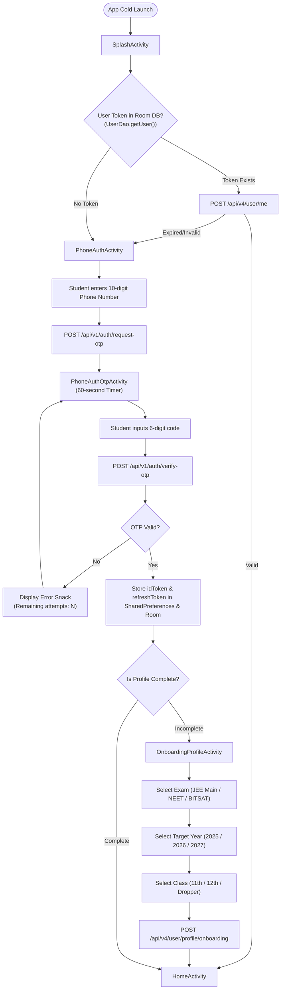
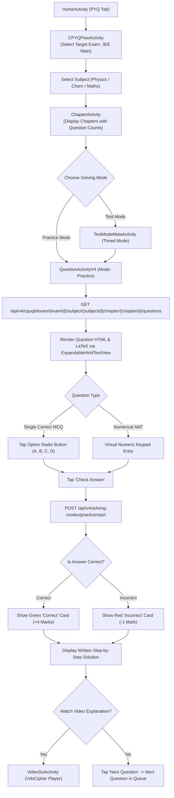
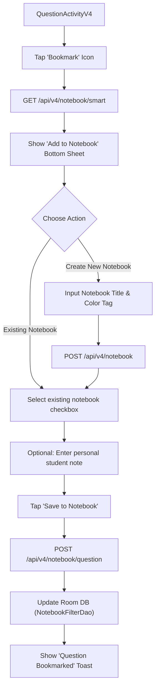
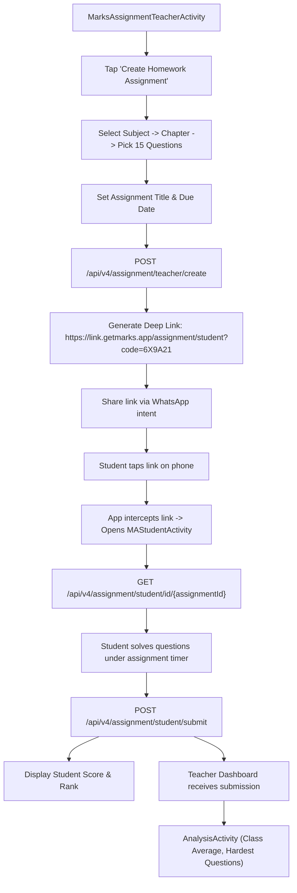
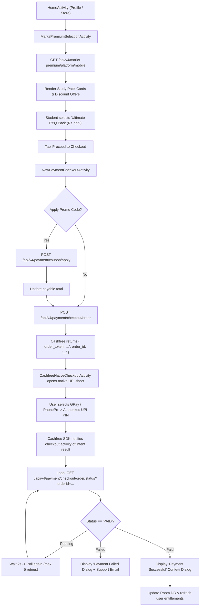
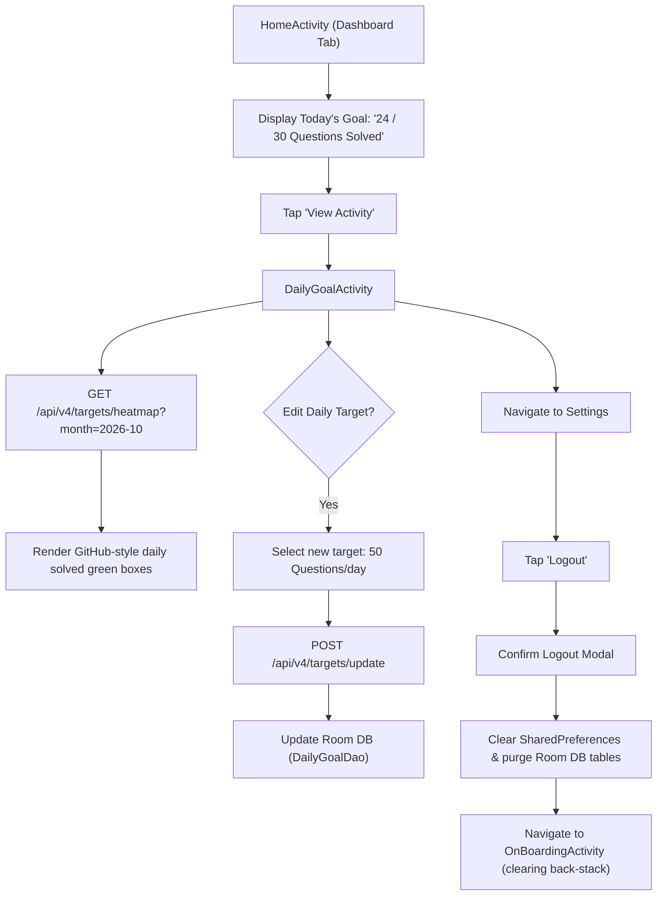

# User Journeys & Interaction Sequences: MARKS Application

## Table of Contents
1. [Journey 1: Onboarding & Authentication](#1-journey-1-onboarding--authentication)
2. [Journey 2: Chapter-wise PYQ Solving (Practice & Test Mode)](#2-journey-2-chapter-wise-pyq-solving)
3. [Journey 3: Custom Test Generator (CTG) & Examination](#3-journey-3-custom-test-generator-ctg--examination)
4. [Journey 4: DRM Video Solutions & Course Streaming](#4-journey-4-drm-video-solutions--course-streaming)
5. [Journey 5: Smart Notebooks & Bookmark Management](#5-journey-5-smart-notebooks--bookmark-management)
6. [Journey 6: Homework Assignment Flow (Teacher $\to$ Student)](#6-journey-6-homework-assignment-flow)
7. [Journey 7: Premium Study Pack Checkout (Cashfree)](#7-journey-7-premium-study-pack-checkout)
8. [Journey 8: Daily Goals, Heatmaps & Account Settings](#8-journey-8-daily-goals-heatmaps--account-settings)
9. [Gaps & Open Questions](#9-gaps--open-questions)

---

## 1. Journey 1: Onboarding & Authentication

### 1.1. Description & Context
A prospective student opens the app for the first time, provides their mobile phone number, receives an SMS OTP, configures their academic profile (target exam, target year, class), and is routed to the personalized dashboard.

### 1.2. Sequence Flowchart



### 1.3. Screens & Endpoints Touched
- **Screens Touched:** `SplashActivity` $\to$ `PhoneAuthActivity` $\to$ `PhoneAuthOtpActivity` $\to$ `OnboardingProfileActivity` $\to$ `HomeActivity`.
- **Endpoints Touched:**
  - `POST https://production.getmarks.app/api/v1/auth/request-otp` (`nu.java#b`)
  - `POST https://production.getmarks.app/api/v1/auth/verify-otp` (`nu.java#d`)
  - `POST https://production.getmarks.app/api/v4/user/profile/onboarding` (`fv.java#O`)
  - `GET https://production.getmarks.app/api/v4/user/me` (`fv.java#u3`)

---

## 2. Journey 2: Chapter-wise PYQ Solving (Practice & Test Mode)

### 2.1. Description & Context
A student selects a subject and chapter (e.g., Mathematics $\to$ "Definite Integration"), configures their filters (e.g., JEE Main 2024, Numerical only), and attempts problems in either Practice Mode (immediate solution verification) or Test Mode.

### 2.2. Sequence Flowchart



### 2.3. Screens & Endpoints Touched
- **Screens Touched:** `HomeActivity` $\to$ `CPYQFlowActivity` $\to$ `ChapterActivity` $\to$ `QuestionActivityV4` $\to$ `VideoSolActivity`.
- **Endpoints Touched:**
  - `GET https://production.getmarks.app/api/v4/cpyqb/exam/{examId}/subject/{subjectId}/chapter/{chapterId}/questions` (`fv.java#z2`)
  - `POST https://production.getmarks.app/api/v4/solving-modes/practice/start` (`fv.java#y`)
  - `GET https://production.getmarks.app/api/v4/questions/{questionId}/hint/feedback-status` (`fv.java#G`)

---

## 3. Journey 3: Custom Test Generator (CTG) & Examination

### 3.1. Description & Context
A student creates a personalized practice examination tailored to their current revision schedule by picking chapters and time limits, taking the exam under NTA CBT conditions, and reviewing their performance.

### 3.2. Sequence Flowchart

```mermaid
flowchart TD
    Home["HomeActivity (Custom Tests Tab)"] --> CTGDash["CustomTestDashboardActivity"]
    CTGDash --> TapCreate["Tap 'Create Custom Test'"]
    TapCreate --> Step1["CustomTestActivity (Step 1)"]

    Step1 --> FetchStep1["GET /api/v4/custom-test/build/step1"]
    FetchStep1 --> SelectSubjects["Select Subjects (Physics, Chemistry, Maths)"]
    SelectSubjects --> Step2["CustomTestActivity (Step 2)"]

    Step2 --> FetchStep2["POST /api/v4/custom-test/build/step2"]
    FetchStep2 --> SelectChapters["Pick Chapters & Set Question Allocation per Chapter"]
    SelectChapters --> SetTimer["Configure Time Duration (30m - 180m)"]
    SetTimer --> SubmitBuild["POST /api/v4/custom-test/generate"]

    SubmitBuild --> TestCreated["Test Created -> Launch CustomTestQuestionActivity"]
    TestCreated --> StartCBT["NTA CBT Test Screen (Timer Counting Down)"]

    loop Question Loop
        StartCBT --> ViewQ["Display Question & Options"]
        ViewQ --> AnsAction{"Student Response"}
        AnsAction -- Answer --> SaveNext["Save & Next -> Turn Green in Palette"]
        AnsAction -- Mark --> MarkNext["Mark for Review -> Turn Purple in Palette"]
        AnsAction -- Clear --> ResetAns["Clear Response"]
    end

    StartCBT --> TimeUp{"Timer Expiry or Tap 'Submit'?"}
    TimeUp -- Yes --> ConfirmModal["Show Attempt Summary Confirmation Modal"]
    ConfirmModal --> ConfirmYes["Confirm Submission"]

    ConfirmYes --> PostSubmit["POST /api/v4/custom-test/submit"]
    PostSubmit --> ReportCard["CustomTestRepordCardActivity"]

    ReportCard --> ViewAnalytics["Display Score, Negative Marks, Accuracy %, Percentile"]
    ViewAnalytics --> TapSolutions["Tap 'Review Solutions' -> CustomTestSolutionActivity"]
```

### 3.3. Screens & Endpoints Touched
- **Screens Touched:** `CustomTestDashboardActivity` $\to$ `CustomTestActivity` $\to$ `CustomTestQuestionActivity` $\to$ `CustomTestRepordCardActivity` $\to$ `CustomTestSolutionActivity`.
- **Endpoints Touched:**
  - `GET https://production.getmarks.app/api/v4/custom-test/build/step1` (`fv.java#n`)
  - `POST https://production.getmarks.app/api/v4/custom-test/build/step2` (`fv.java#q`)
  - `POST https://production.getmarks.app/api/v4/custom-test/submit` (`fv.java#T`)
  - `GET https://production.getmarks.app/api/v4/custom-test/analysis/{testId}` (`fv.java#r`)

---

## 4. Journey 4: DRM Video Solutions & Course Streaming

### 4.1. Description & Context
A student studying a complex concept taps "Watch Video Solution" on a difficult question or navigates through an enrolled video course. The app securely acquires an OTP token and launches the VdoCipher hardware-encrypted player.

### 4.2. Sequence Flowchart

```mermaid
flowchart TD
    QuestionScreen["QuestionActivityV4 / MarksCoursesActivity"] --> TapVideo["Tap 'Watch Video'"]
    TapVideo --> CheckSub{"Is User Subscribed or Demo Lecture?"}

    CheckSub -- Not Subscribed --> PremiumPrompt["MarksPremiumSelectionActivity (Upsell Modal)"]

    CheckSub -- Authorized --> ReqOTP["POST /api/v4/courses/.../content/{contentId}/video/otp"]
    ReqOTP --> ServerVerify["Server verifies user entitlements"]
    ServerVerify --> ReturnToken["Return { otp: '...', playbackInfo: '...' }"]

    ReturnToken --> LaunchPlayer["VideoSolActivity / PlayerActivity"]
    LaunchPlayer --> InitVdo["VdoCipher Aegis SDK initializes Widevine DRM pipeline"]
    InitVdo --> RenderStream["Encrypted playback starts with dynamic user watermark"]

    loop Every 15 Seconds of Watch Time
        RenderStream --> SendHeartbeat["POST /api/v4/courses/video/progress { position, duration }"]
    end

    RenderStream --> Finished{"Video Finished?"}
    Finished -- Yes --> MarkDone["POST /api/v4/courses/.../mark-video-complete"]
```

### 4.3. Screens & Endpoints Touched
- **Screens Touched:** `QuestionActivityV4` $\to$ `VideoSolActivity` / `MarksCoursesActivity`.
- **Endpoints Touched:**
  - `GET https://production.getmarks.app/api/v4/courses/.../content/{contentId}/video/otp` (`fv.java#f`, `fv.java#v`)
  - `POST https://production.getmarks.app/api/v4/courses/video/mark` (`fv.java#g`)

---

## 5. Journey 5: Smart Notebooks & Bookmark Management

### 5.1. Description & Context
While practicing, a student flags tricky questions into custom notebooks (e.g., "Organic Reaction Mechanisms") and reviews them before an exam.

### 5.2. Sequence Flowchart



### 5.3. Screens & Endpoints Touched
- **Screens Touched:** `QuestionActivityV4` $\to$ `NotebookListActivity` $\to$ `BookmarkedQsListActivity`.
- **Endpoints Touched:**
  - `GET https://production.getmarks.app/api/v4/notebook/smart` (`fv.java#z3`)
  - `POST https://production.getmarks.app/api/v4/notebook` (`fv.java#z`)
  - `POST https://production.getmarks.app/api/v4/notebook/question` (`fv.java#z0`)

---

## 6. Journey 6: Homework Assignment Flow (Teacher $\to$ Student)

### 6.1. Description & Context
A coaching teacher selects 15 PYQs from the question repository, sets a deadline, and shares a deep link on WhatsApp. A student opens the link, completes the assignment on their phone, and the teacher reviews classroom analytics.

### 6.2. Sequence Flowchart



### 6.3. Screens & Endpoints Touched
- **Screens Touched:** `MarksAssignmentTeacherActivity` $\to$ `AssignmentQuestionsListFragment` $\to$ `MAStudentActivity` $\to$ `AnalysisActivity`.
- **Endpoints Touched:**
  - `POST https://production.getmarks.app/api/v4/assignment/teacher/create` (`fv.java#s`)
  - `GET https://production.getmarks.app/api/v4/assignment/student/id/{assignmentId}` (`fv.java#S`)
  - `GET https://production.getmarks.app/api/v4/assignment/student/id/{assignmentId}/analysis` (`fv.java#v2`)

---

## 7. Journey 7: Premium Study Pack Checkout (Cashfree)

### 7.1. Description & Context
A student unlocks the "JEE Main 2026 Ultimate Video Solutions Pack" using native UPI checkout powered by Cashfree.

### 7.2. Sequence Flowchart



### 7.3. Screens & Endpoints Touched
- **Screens Touched:** `MarksPremiumSelectionActivity` $\to$ `NewPaymentCheckoutActivity` $\to `CashfreeNativeCheckoutActivity`.
- **Endpoints Touched:**
  - `GET https://production.getmarks.app/api/v4/marks-premium/platform/mobile` (`fv.java#x0`)
  - `POST https://production.getmarks.app/api/v4/payment/checkout/order` (`fv.java#u`)
  - `GET https://production.getmarks.app/api/v4/payment/checkout/order/status` (`fv.java#y1`)

---

## 8. Journey 8: Daily Goals, Heatmaps & Account Settings

### 8.1. Description & Context
A student checks their daily goal progress, visualizes their monthly consistency heatmap, and manages notifications or logs out.

### 8.2. Sequence Flowchart



---

## 9. Gaps & Open Questions

1. **UPI Timeout Handling:** If the native UPI application crashes or takes longer than 60 seconds to respond, does the client cancel the order token automatically? This should be verified with live Cashfree logs `[INFERRED]`.
2. **Offline Goal Sync:** If a student solves 20 questions offline, does the heatmap reflect those attempts immediately using Room data, or only after the background sync worker completes? `[INFERRED]`.
