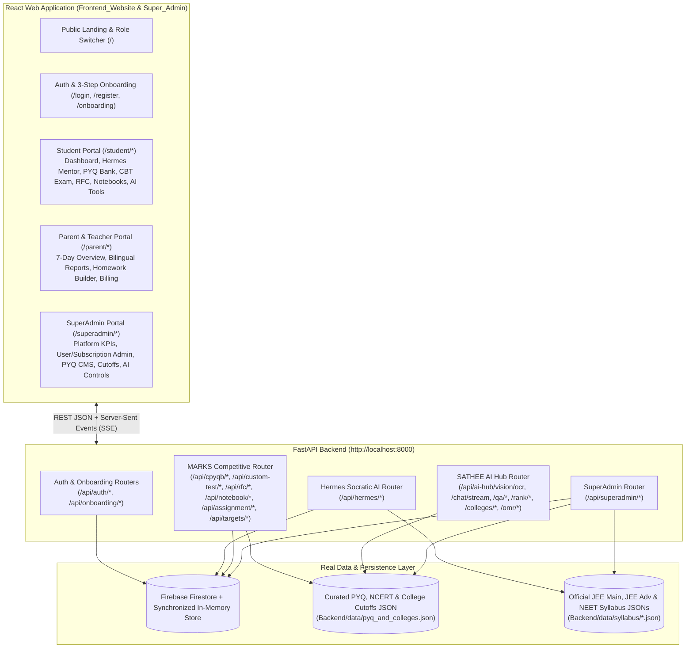

# Implementation Plan (`plan.md`)
## eKlAVYA / Mentor AI — Complete React Web Application, Real Data Layer & SuperAdmin Portal

> **Goal:** Build a complete, production-grade, end-to-end working React web application (`Frontend_Website` & `Super_Admin`) integrated with the FastAPI backend (`Backend/main.py`) using real syllabus, PYQ, flashcard, college cutoff, and Firestore/in-memory user data across three distinct role portals: **Student Portal**, **Parent/Teacher Portal**, and **SuperAdmin Portal**.

---

## 1. Architecture & System Overview

---

## 2. Phase-by-Phase Execution Plan

### Phase 1: Real Data Enrichment & SuperAdmin Backend API (`Backend/`)
1. **Expand Real Curated Dataset (`Backend/data/pyq_and_colleges.json`):**
   - Enrich `pyq_questions` with authentic JEE Main, JEE Advanced, and NEET-UG questions across **Physics**, **Chemistry**, **Mathematics**, and **Biology** (both `MCQ` and `NAT` numerical types, complete with LaTeX statements/solutions, NCERT page mappings, shift labels, and `high_yield` / `must_revise` / `trap_zone` badges).
   - Expand `ncert_modules` across Class 11 & 12 Physics, Chemistry, and Biology.
   - Expand `colleges` with multi-year JoSAA / MCC cutoff ranks across categories (`General`, `OBC-NCL`, `EWS`, `SC`, `ST`) for top IITs, NITs, and AIIMS institutes.
2. **Build SuperAdmin Backend Router (`Backend/routers/superadmin_router.py`):**
   - `POST /api/superadmin/login`: Authenticate SuperAdmin credentials and issue a role-scoped JWT token.
   - `GET /api/superadmin/overview`: Real-time platform telemetry (registered parents/students, PYQ count, flashcard count, active custom tests, homework assignments, active Concept Walls, subscription distribution, and service health).
   - `GET /api/superadmin/users`, `POST /api/superadmin/users/seed-demo`, `PATCH /api/superadmin/users/{role}/{id}`, `DELETE /api/superadmin/users/{role}/{id}`: Inspect and manage Parent and Student accounts, toggle `premium` subscriptions, clear locked Concept Walls, and seed pre-populated demo accounts.
   - `GET /api/superadmin/questions`, `POST /api/superadmin/questions`, `PUT /api/superadmin/questions/{id}`, `DELETE /api/superadmin/questions/{id}`: Full CRUD on the PYQ question bank with immediate persistence to `pyq_and_colleges.json` and hot-reload into `CPYQBAndCTGService` and `MarksEcosystemService`.
   - `GET /api/superadmin/flashcards`, `POST /api/superadmin/flashcards`, `DELETE /api/superadmin/flashcards/{id}`: Manage Revision Flash Cards (RFC) and formula decks.
   - `GET /api/superadmin/colleges`, `PUT /api/superadmin/colleges/{id}`: Manage IIT/NIT/AIIMS branch cutoffs.
   - `GET /api/superadmin/system-config`, `PUT /api/superadmin/system-config`: Configure platform-wide AI turn caps (`free_daily_turns`, `premium_daily_turns`), mastery thresholds, and inspect audit logs.
3. **Resilient Demo & Auth Seeding:**
   - Ensure deterministic startup seeding of demo Parent (`rajesh@eklavya.ai`), Student (`aarav_jee2026`), and SuperAdmin (`admin@eklavya.ai`) accounts along with pre-populated activity heatmaps, league standings, homework assignments, and syllabus micro-topics so every chart and screen renders rich real data immediately on launch.

---

### Phase 2: React Frontend Foundation & Design System (`Frontend_Website/`)
1. **Technology Stack:**
   - **React 19 + TypeScript + Vite** (fast HMR, zero-config bundling, clean SPA routing via `react-router-dom` v7) + **Tailwind CSS** + **KaTeX** (`katex` for instant `$...$` and `$$...$$` mathematical rendering) + **Lucide React** icons.
2. **Core Infrastructure (`src/lib/` & `src/context/`):**
   - `api.ts`: Axios client configured with base URL `http://localhost:8000`, automatic `Authorization: Bearer <token>` injection, and 401 refresh handling.
   - `sse.ts`: Streaming EventSource reader for `POST /api/ai-hub/chat/stream` parsing `analyzing` $\to$ `reasoning` $\to$ `solution` chunks in real time.
   - `LatexText.tsx`: Sanitized HTML + KaTeX mathematical renderer supporting inline `$...$` and display `$$...$$` equations.
   - `AuthContext.tsx`: Multi-role session management (`student`, `parent`, `superadmin`) with 1-click Demo Role Switcher in the top bar for effortless testing across all portals.

---

### Phase 3: Student Portal Implementation (`/student/*`)
1. **Student Home Hub (`/student/dashboard`):**
   - Target Exam switcher (`JEE Main`, `JEE Advanced`, `NEET-UG`), live exam countdown, XP/Streak/League badges (`GET /api/hermes/today`, `GET /api/hermes/gamification`).
   - Conditional Amber **Concept Wall Alert Banner** when a micro-topic is locked.
   - **Daily Dose 5-Question Sprint** interactive modal (`GET /api/targets/daily-dose`, `POST /api/targets/daily-dose/submit`).
   - **GitHub-Style Monthly Consistency Heatmap** (`GET /api/targets/heatmap`) + Daily Goal editor (`POST /api/targets/update`).
   - **Weekly League Leaderboard** (`GET /api/leaderboard/achievements`) & AI Score Prediction card (`GET /api/hermes/score-prediction`).
2. **Hermes 1-to-1 Socratic AI Mentor & Vision OCR (`/student/mentor`):**
   - Left syllabus micro-topic tree (`GET /api/hermes/topics`, `GET /api/hermes/progress`) showing `UNTOUCHED`, `LEARNING`, `MASTERED`, and `WALL` states.
   - 11-language selector (`English`, `हिंदी`, `Hinglish`, `मराठी`, `தமிழ்`, `తెలుగు`, etc.).
   - Dual AI modes: **1-to-1 Socratic Mentor Chat** (`POST /api/hermes/chat`) and **3-Stage SSE Streaming Doubt Solver** (`POST /api/ai-hub/chat/stream`).
   - **Snap & Solve Vision OCR** (`POST /api/ai-hub/vision/ocr`) for image/equation upload and extraction.
   - **Topic Mastery Quiz Drawer** (`POST /api/hermes/quiz/attempt`) to transition states (`UNTOUCHED -> LEARNING -> MASTERED`) or clear an active Concept Wall.
3. **Chapter-wise PYQ Bank & NEET NCERT Hub (`/student/pyq`):**
   - Granular filters: Exam, Subject, Chapter, Year, Type (`MCQ`/`NAT`), Difficulty, Attempt Status, and Revision Zone (`high_yield`, `must_revise`, `trap_zone`).
   - **NEET NCERT Line-by-Line Modules** view (`GET /api/neet/ncert/subject/{subject}/modules`).
   - **Interactive Question Workspace**: Option cards for MCQ, custom **Virtual Numeric Keypad** for NAT questions, instant grading (`POST /api/solving-modes/practice/start`), step-by-step LaTeX solution, **Bookmark to Smart Notebook** (`POST /api/notebook/question`), and **Generate 3 Similar Questions** (`POST /api/ai-hub/qa/generate-similar-questions`).
4. **Tests, Custom Test Generator (CTG) & Fullscreen NTA CBT Arena (`/student/tests` & `/student/exam/:testId`):**
   - **2-Step CTG Wizard** (`GET /api/custom-test/build/step1` $\to$ `POST /api/custom-test/build/step2` $\to$ `POST /api/custom-test/generate`).
   - **Fullscreen NTA CBT Interface**: Live countdown timer, subject tabs, 4-state NTA question palette (`Not Visited`, `Unattempted`, `Answered`, `Marked for Review`), `Save & Next`, `Mark for Review & Next`, `Clear Response`, and local storage auto-save.
   - **Post-Test Diagnostic Report Card** (`POST /api/custom-test/submit`, `GET /api/custom-test/analysis/{testId}`) with Topper Speed & Score comparison and question-by-question solutions.
   - **Student Homework Assignments**: Join via 6-character `joinCode` (`GET/POST /api/assignment/student/id/{code}`) and view live classroom rank.
5. **Revision Flash Cards (RFC) & Smart/Error Notebooks (`/student/revision`):**
   - **Interactive 3D Flip Flashcards** (`GET /api/rfc/subject/{s}/chapter/{c}/cards`, `POST /api/rfc/mastery`).
   - **Smart Notebooks** (`GET /api/notebook/smart`, `POST /api/notebook`, `PATCH /api/notebook/{id}`, `GET /api/notebook/{id}/questions`).
   - **Automated Error Notebook** (`GET /api/notebook/errors`, `POST /api/notebook/errors/{id}/resolve`) with mistake-type filters and 1-click isomorphic practice generation.
6. **Admissions & OMR Utilities (`/student/tools`):**
   - **AI Rank & Category Percentile Predictor** (`POST /api/ai-hub/rank/predict`).
   - **IIT / NIT / AIIMS College Cutoff Explorer** (`GET /api/ai-hub/colleges/cutoffs`) with automatic branch eligibility calculation.
   - **Physical OMR Sheet Scanner & Grader** (`POST /api/ai-hub/omr/evaluate`) with bubble grid editor and direct pipe to Rank Predictor.

---

### Phase 4: Parent & Teacher Portal Implementation (`/parent/*`)
1. **Parent Overview & Alerts (`/parent/dashboard`):**
   - 7-day activity metrics, syllabus mastery progress, and high-priority `attention_flags` (`concept_wall_active`, `streak_at_risk`, `inactive_48h`) (`GET /api/hermes/parent/overview`).
2. **Bilingual Daily & Weekly Reports (`/parent/reports`):**
   - Generate & view localized daily summaries (`POST /api/hermes/summary/generate/{child_id}`, `GET /api/hermes/summary/{child_id}?audience=parent`) and 7-day breakdown (`GET /api/hermes/parent/weekly`).
3. **Teacher/Parent Homework Builder & Classroom Analytics (`/parent/assignments`):**
   - Select PYQs, set duration and due date, generate 6-char `joinCode` & shareable link (`POST /api/assignment/teacher/create`), and inspect classroom leaderboard & question-level error rates (`GET /api/assignment/student/id/{code}/analysis`).
4. **Subscriptions & Billing (`/parent/billing`):**
   - Plan comparison (`free`, `premium_monthly`, `premium_yearly`) (`GET /api/payment/plans`), order creation (`POST /api/payment/create-order`), and instant verification (`POST /api/payment/verify`).

---

### Phase 5: SuperAdmin Portal Implementation (`/superadmin/*` & `Super_Admin/`)
1. **Platform Command Center (`/superadmin/dashboard`):**
   - Real-time KPIs, system health, AI engine status, and 1-click demo data seeding.
2. **User & Subscription Directory (`/superadmin/users`):**
   - Manage Parents and Students, inspect XP/streaks/Concept Walls, unlock Concept Walls, and grant/revoke Premium plans.
3. **PYQ Question Bank CMS (`/superadmin/questions`):**
   - Full CRUD interface to create, edit, preview (with live KaTeX math), and delete PYQ questions in real time.
4. **Flashcards, NCERT & College Cutoffs Manager (`/superadmin/content`):**
   - Create/delete RFC formula cards and update IIT/NIT/AIIMS branch cutoff ranks.
5. **AI & Syllabus Governance (`/superadmin/ai-settings`):**
   - Seed micro-topics from `data/syllabus/*.json`, configure daily turn limits and mastery thresholds, and inspect platform audit logs.

---

### Phase 6: Verification & End-to-End Testing
1. Start the FastAPI backend (`uvicorn main:app --port 8000`) and React frontend (`npm run dev` on port `3000`).
2. Verify all API endpoints, real data persistence, LaTeX math rendering, SSE streaming, CBT exam grading, and SuperAdmin live mutations.
